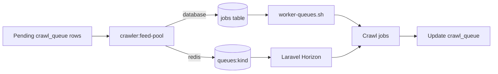

# Queue operations

## Topology

`crawl_queue` is the source of truth for crawl work. The feed-pool command claims rows only when the matching Laravel queue has capacity; workers complete the job and update the same crawl row.



Redis is the standard queue connection. Database queue support remains available when `QUEUE_CONNECTION=database` is explicitly selected; its depth check counts rows in the configured `jobs` table that are not reserved and are available now. Redis mode reads `LLEN queues:<name>` through Laravel's Redis connection, so feed-pool backpressure reflects the shared Redis queue rather than the database `jobs` table. Redis keys use `REDIS_PREFIX=javmeta:`; test runs use `javmeta_it:`.

A JavBTC detail that has no recognizable product code is stored as a terminal `parse_failed` crawl row with a plain reason. JavBTC codes found in the page fields, title, or URL are normalized; no code is inferred when those sources contain none.

## Redis and Horizon configuration

Set these values in the private application environment. Workspaces projects use the shared Redis service and the project indexes generated by `scripts/docker/shared env-project javmeta --mode live|test|wt:<id>`. Keep Redis credentials out of tracked files. Use `QUEUE_CONNECTION=database` only for installations that explicitly retain the database queue.

```dotenv
QUEUE_CONNECTION=redis
REDIS_HOST=<shared Redis host>
REDIS_PORT=6379
REDIS_DB=<project queue index>
REDIS_CACHE_DB=<project cache index>
REDIS_USERNAME=<shared Redis username>
REDIS_PASSWORD=<shared Redis password>
REDIS_PREFIX=javmeta:
REDIS_QUEUE_RETRY_AFTER=240
HORIZON_PREFIX=javmeta:horizon:
JAVMETA_WORKERS_PER_QUEUE=1
JAVMETA_QUEUE_TIMEOUT=180
JAVMETA_QUEUE_DEPTH_LIMIT=100
```

Horizon supervises `listing`, `detail`, `performer_listing`, `performer_detail`, `gallery`, and `search` in `production`, `local`, and `testing`. The shared queue-name list in `config/javmeta_queues.php` includes `search`; only the five crawl kinds map to `crawl_queue` rows and are claimed by the feed pool. Supervisors read their process count and timeout from `JAVMETA_WORKERS_PER_QUEUE` and `JAVMETA_QUEUE_TIMEOUT`. Keep the timeout below the queue connection's `retry_after`; the defaults leave a 60-second margin. `horizon:terminate` waits for running jobs because `fast_termination` is disabled.

Movie and performer persistence dispatches a unique job to `search` after the database transaction commits. The crawl worker does not call Elasticsearch or the embedder; Horizon handles indexing with up to three attempts and delays of 10 and 60 seconds between retries. A failed job is recorded by Laravel's configured failed-job store and Horizon. `JAVMETA_SEARCH_ENABLED=false` prevents new indexing jobs from being dispatched; queued jobs also exit without indexing while the switch is off.

Shared integration tests use the Workspaces Redis account on the project's own database indexes (`provision-project javmeta --redis`: live and test indexes) and the key prefixes `javmeta:`, `javmeta_test:` and `javmeta_wt<id>:`; the shared Redis service has one root account and no per-project Redis users or ACLs. `docker/ci/integration-shared` verifies the target with `check-project` first.

## Backpressure

`JAVMETA_QUEUE_DEPTH_LIMIT` is the maximum ready Laravel-job backlog per crawl queue. Before claiming rows, `crawler:feed-pool` compares each queue's ready depth to that limit. A full queue emits the `pool_gated` ops event and leaves its crawl rows pending. When the queue drains, later feed-pool runs claim up to `depth_limit - ready_depth`, bounded by `--limit`.

The depth check covers ready jobs. Reserved and delayed Redis jobs do not count toward this buffer. A Redis depth-query failure stops the feed-pool command before it claims rows.

Claiming a crawl row does not increment `attempts`. A worker increments it once when it starts the current claim, and the claim token prevents an older buffered job from starting after that claim has been reclaimed. Stale claims that never started return to pending with the same attempt count; stale started claims retain the existing worker-lost retry behavior. Existing claimed rows are marked started by the schema migration because the previous schema cannot distinguish buffered jobs from jobs already running.

Each stale claim reclaimed before worker start creates a `queue_reclaimed_without_start` crawl event. The count is reported for the previous five minutes by `javmeta_crawl_events_5m` with `kind=queue_reclaimed_without_start`.

## Listing freshness

`crawler:seed` runs every minute. It requeues each configured page-one movie, performer, or gallery listing after `JAVMETA_FRESH_INTERVAL_MINUTES` (default `60`), even when later pages in that listing chain are still pending. The existing queue row is reset in place, and the source's current request gap still delays the next attempt. Listing results continue to enqueue detail pages through the existing queue path; already known detail rows are not reset by this refresh.

When every page in a listing chain is finished, the loop still restarts page one after `JAVMETA_LOOP_PAUSE_SECONDS` (default `300`). This end-of-chain pause remains independent of the page-one freshness interval.

## Incomplete movie recrawls

`crawler:recrawl-incomplete` keeps using `JAVMETA_RECRAWL_DAYS` (7 days by default) and only selects movies below `JAVMETA_RECRAWL_MIN_TIER`. `JAVMETA_RECRAWL_MAX` defaults to 3 consecutive successful recrawls without a newly populated movie field. New movie data resets the count; at the limit, the movie is marked `complete_as_possible` and later recrawl runs skip it.

Use `php artisan crawler:recrawl-stopped` to list stopped movies by code and no-progress rounds. `php artisan crawler:recrawl-stopped --reset` clears the stopped status and counter for all stopped movies so they can be considered by a later recrawl run.

## Deploy and operate

The Compose worker starts `php artisan horizon` when `QUEUE_CONNECTION=redis` (the default); with `QUEUE_CONNECTION=database` it keeps running `crawlerx-fetch-ready worker-queues`. The Redis worker healthcheck uses `php artisan horizon:status`.

Before replacing an application image, run `php artisan horizon:terminate` on the old release. Horizon stops accepting new work and waits for running jobs to finish; `fast_termination` stays disabled. Let the container supervisor start Horizon from the new release, then verify with `php artisan horizon:status`. If a job exceeds the configured timeout, its failure and retry behavior still follows Laravel's queue settings.

The dashboard route is `/horizon`. `HorizonServiceProvider` uses the same `X-Owner-Token` header and `JAVMETA_OWNER_ADMIN_TOKEN` value as `OwnerAdminGuard`. Keep the app listener private. For browser access, use a trusted loopback-only reverse proxy that injects the header for authenticated operators; do not put the token in the URL. A missing or empty token denies dashboard requests in every environment.

See the [Laravel Horizon documentation](https://laravel.com/docs/13.x/horizon) for the dashboard and worker commands.
