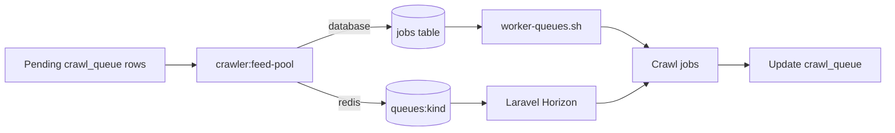

# Queue operations

## Topology

`crawl_queue` is the source of truth for crawl work. The feed-pool command claims rows only when the matching Laravel queue has capacity; workers complete the job and update the same crawl row.

The scheduler checks `crawler:feed-pool --scheduled` every five seconds. The
command reads the current `queue.feed_interval_seconds` database setting on
each run, so edits apply without restarting the scheduler. Successful dispatches
update a shared-cache heartbeat; `obs:publish-metrics` exports its age and
warning/critical state while due crawl rows remain pending. Scheduled Artisan
command failures are written to the application log.



Redis is the standard queue connection. Database queue support remains available when `QUEUE_CONNECTION=database` is explicitly selected; its depth check counts rows in the configured `jobs` table that are not reserved and are available now. Redis mode reads `LLEN queues:<name>` through Laravel's Redis connection, so feed-pool backpressure reflects the shared Redis queue rather than the database `jobs` table. Redis keys use `REDIS_PREFIX=javmeta:`; test runs use `javmeta_it:`.

A JavBTC detail without a recognizable product code uses a stable `JAVBTC-DERIVED-<SHA256>` identity from its `/r18/<slug>` path. Recognizable codes from page fields, title or URL path take precedence. A code-less page without a valid detail path still becomes a terminal `parse_failed` row with a plain reason.

## Redis and Horizon configuration

Set these infrastructure values in the private application environment. Queue
worker counts, names, limits, retry/backoff and timeouts live on Cài đặt.
Workspaces projects use the shared Redis service and project indexes generated
by `scripts/docker/shared env-project javmeta --mode live|test|wt:<id>`. Keep
Redis credentials out of tracked files. Use `QUEUE_CONNECTION=database` only
for installations that explicitly retain the database queue.

```dotenv
QUEUE_CONNECTION=redis
REDIS_HOST=<shared Redis host>
REDIS_PORT=6379
REDIS_DB=<project queue index>
REDIS_CACHE_DB=<project cache index>
REDIS_USERNAME=<shared Redis username>
REDIS_PASSWORD=<shared Redis password>
REDIS_PREFIX=javmeta:
HORIZON_PREFIX=javmeta:horizon:
```

Horizon supervises the configured queue-name list from `worker.queue_names`;
only the five crawl kinds map to `crawl_queue` rows and are claimed by the feed
pool. API usage telemetry is sent to `observability` so an OpenObserve request
does not add network latency to API responses. Its `api-observability`
supervisor is separate from the crawl and search supervisors. Each supervisor
uses the database worker count and timeout settings; `queue.retry_after_seconds`
must exceed `queue.worker_timeout`. `horizon:terminate` waits for running jobs
because `fast_termination` is disabled.
On systemd nodes, use `systemctl restart <unit-prefix>-horizon` for an immediate
reload: a clean Horizon exit does not activate the unit's `Restart=on-failure`
policy.

Movie and performer persistence dispatches a unique job to `search` after the database transaction commits. The crawl worker does not call Elasticsearch or the embedder; Horizon handles indexing with the configured database retry count and backoff. A failed job is recorded by Laravel's configured failed-job store and Horizon. `search.enabled` prevents new indexing jobs from being dispatched; queued jobs also exit without indexing while the switch is off.

Shared integration tests use the Workspaces Redis account on the project's own database indexes (`provision-project javmeta --redis`: live and test indexes) and the key prefixes `javmeta:`, `javmeta_test:` and `javmeta_wt<id>:`; the shared Redis service has one root account and no per-project Redis users or ACLs. `docker/ci/integration-shared` verifies the target with `check-project` first.

## Backpressure

API span telemetry uses deterministic sampling based on the trace ID (10% by default) and is enqueued only when the configured observability queue backlog is below `queue.observability_depth_limit` (1,000 by default). Spans are skipped when the queue is full or `QUEUE_CONNECTION=sync`, keeping OpenObserve delivery out of synchronous API requests and bounding telemetry backlog.

`queue.observability_sample_percent` adjusts sampling from 0 to 100. `queue.observability_depth_limit` bounds ready observability jobs.

`queue.depth_limit` is the maximum ready Laravel-job backlog per crawl queue. Before claiming rows, `crawler:feed-pool` compares each queue's ready depth to that limit. A full queue emits the `pool_gated` ops event and leaves its crawl rows pending. When the queue drains, later feed-pool runs claim up to `depth_limit - ready_depth`, bounded by `--limit`.

The depth check covers ready jobs. Reserved and delayed Redis jobs do not count toward this buffer. A Redis depth-query failure stops the feed-pool command before it claims rows.

Claiming a crawl row does not increment `attempts`. A worker increments it once when it starts the current claim, and the claim token prevents an older buffered job from starting after that claim has been reclaimed. Stale claims that never started return to their lane with the same attempt count; stale started claims use the same normal-attempt backoff and retry-lane state machine as other transient failures. Existing claimed rows are marked started by the schema migration because the previous schema cannot distinguish buffered jobs from jobs already running.

Each stale claim reclaimed before worker start creates a `queue_reclaimed_without_start` crawl event. The count is reported for the previous five minutes by `javmeta_crawl_events_5m` with `kind=queue_reclaimed_without_start`.

## Listing freshness

`crawler:seed` runs every minute. It requeues each configured page-one movie, performer, or gallery listing after `crawl.fresh_interval_minutes` (default `60`), even when later pages in that listing chain are still pending. The existing queue row is reset in place, and the source's current request gap still delays the next attempt. Listing results continue to enqueue detail pages through the existing queue path; already known detail rows are not reset by this refresh.

When every page in a listing chain is finished, the loop still restarts page one after `crawl.loop_pause_seconds` (default `300`). This end-of-chain pause remains independent of the page-one freshness interval.

## Incomplete movie recrawls

`crawler:recrawl-incomplete` uses the database `crawl.recrawl_days` (7 days by default) and only selects movies below `crawl.recrawl_min_tier`. `crawl.recrawl_max` defaults to 3 consecutive successful recrawls without a newly populated movie field. New movie data resets the count; at the limit, the movie is marked `complete_as_possible` and later recrawl runs skip it.

Use `php artisan crawler:recrawl-stopped` to list stopped movies by code and no-progress rounds. `php artisan crawler:recrawl-stopped --reset` clears the stopped status and counter for all stopped movies so they can be considered by a later recrawl run.

## Deploy and operate

The Compose worker starts `php artisan horizon` when `QUEUE_CONNECTION=redis` (the default); with `QUEUE_CONNECTION=database` it keeps running `crawlerx-fetch-ready worker-queues`. The Redis worker healthcheck uses `php artisan horizon:status`.

Before replacing an application image, run `php artisan horizon:terminate` on the old release. Horizon stops accepting new work and waits for running jobs to finish; `fast_termination` stays disabled. Let the container supervisor start Horizon from the new release, then verify with `php artisan horizon:status`. If a job exceeds the configured timeout, its failure and retry behavior still follows Laravel's queue settings.

The dashboard route is `/horizon`. `HorizonServiceProvider` uses the owner token in the database setting `ui_security.owner_admin_token`, shared with `OwnerAdminGuard`. Keep the app listener private. For browser access, use a trusted loopback-only reverse proxy that injects the header for authenticated operators; do not put the token in the URL. A missing or empty token denies dashboard requests in every environment.

See the [Laravel Horizon documentation](https://laravel.com/docs/13.x/horizon) for the dashboard and worker commands.


## Fairness between sources

`CrawlQueueService::claimNext` skips a source that already has `queue.per_source_inflight` (default 4) claimed, unfinished
rows of the same kind, so one source with thousands of older rows cannot fill the worker queue and starve the others.
Parallelism comes from `queue.workers_per_queue` and its lane, queue and node overrides; each source is still limited by its own
throttle gap.


## Request pacing and adaptive gap

The gap between requests of one source (`sources.gap_seconds_current`, between its min and max) is enforced when the
feed pool hands out work: a source may have at most `floor(queue.pacing_horizon_seconds / gap)` rows waiting (default
horizon 60 seconds), and its jobs are delayed so that they start one gap apart. Rows that are still claimed from an
earlier run count against the budget. The gap adapts to the answers of the site: rate limits, blocks and challenges
double it up to `queue.gap_blocked_max_seconds` (default 600), or the override `max` for an overridden source; timeouts and network errors raise it by half up to the
source maximum; parse and not-found errors do not change it; every success lowers it by 10 percent of the distance to
its minimum. The current adaptive gap is in `crawler:sources`, the status API and the metric `javmeta_source_gap_seconds`.

`crawl.source_gap_overrides` is a database setting on Cài đặt → Vòng lặp crawl.
It maps source slugs to `{ "min": 20, "default": 30, "max": 60 }`; every value
must be from 0.25 to 600 seconds and satisfy `min <= default <= max`. With an
empty map, source definitions and existing adaptive behavior are unchanged.
`crawler:sync-sources` applies configured overrides to source rows and clamps
their current adaptive value to the override bounds, including persisted
sources that are no longer in the definitions. The feeder uses that effective
adaptive gap for its source budget and job delays. Workers reserve request start
slots in shared Redis so sub-second overrides are kept when same-source jobs
become ready together. Inspect the source definition, override, effective bounds and current adaptive value with
`php artisan crawler:source-gap [slug] [--json]`.

The PostgreSQL claim path also has the partial index
`crawl_queue_pending_kind_id_idx` on `(kind, id)` for pending rows. Its migration
uses `CREATE INDEX CONCURRENTLY IF NOT EXISTS`; a valid index already present is
left in place, and an invalid leftover is dropped concurrently before retry.
The integration test checks its columns, pending predicate, validity and
idempotent repeat. A pinned `EXPLAIN` plan is not stable across environments:
PostgreSQL chooses plans from table size, row distribution and collected
statistics. To inspect a representative plan, run `ANALYZE crawl_queue` and
`EXPLAIN` the production claim predicate on the target database.

## Feed pool diagnostics

The budget records the last feed run; the displayed effective and adaptive gap
columns show the current values.

Feed-pool diagnostics are enabled by default through the database setting
`queue.feed_diagnostics.enabled`. The database setting
`queue.feed_diagnostics.retention_minutes` controls how long minute buckets stay
in Redis (default 120 minutes, minimum 3, maximum 1,440). Each run writes its source
snapshot, per-queue stop reason, run duration and claim candidate count in one
Redis pipeline; Redis TTL removes expired buckets. Instrumentation errors are
ignored by the feed command.

Run `php artisan crawler:feed-diagnostics --minutes=10` to read retained data
over SSH. The command caps its window at the configured retention period. The
per-source table shows the latest budget, started and waiting snapshot in the
window, plus dispatched rows summed over the window, effective default gap,
whether an override is active, and current adaptive gap. Started counts requests
recorded within `queue.pacing_horizon_seconds`; waiting counts claimed rows
without a start time. The budget uses the effective adaptive gap; without an
override, the legacy one-second minimum remains in force. Stop-reason classification matches
the due rows for each queue kind and lane in the claim statement. Reasons are
counted by queue and lane: `exhausted_budget`, `no_due_rows`, `depth`,
`global_cap`, `advisory_lock`, `per_source_inflight` and `interval_not_elapsed`.
`advisory_lock` includes feed or scheduled-interval lock contention;
`interval_not_elapsed` means the scheduled interval is still pending.
Run time is shown as the total for the window. The `claimNext` candidate count
increments when claim selection or a source-gate check finds a row (up to one
per call); it does not estimate rows scanned internally by the database engine.


## Direct, browser and retry lanes

`crawl.lanes_enabled` (Settings UI, default true) separates the five crawl kinds into
`listing`, `detail`, `performer_listing`, `performer_detail`, `gallery` and their
`browser_` counterparts. The five `retry_` queues form a third, always separate
lane. Each lane queue has its own Horizon supervisor; retry workers default to
one process per queue. Search indexes application data rather than fetching a
source; `search` and `observability` keep their existing queues.

The static `queue.browser_sources` list is the default browser lane. The complete
04:00 `crawler:source-health` run also aggregates the preceding 24 hours of
`crawl_fetch_attempts` (excluding skipped attempts). At least 40 attempts and at
least 25% FlareSolverr/Playwright attempts assign a source to browser. The two
thresholds are `crawl.lane_min_attempts` and `crawl.lane_browser_percent`. The
snapshot is stored in `sources.browser_lane`; insufficient or expired history
clears a computed decision. Runtime-escalating sources such as heyzo therefore
join the browser cap after classification without editing the static list.
A first unseen escalation can occur before the next daily classification; pin a
known browser-dependent source immediately when operational evidence requires it.

Manual `crawl.lane_browser_pins` and `crawl.lane_direct_pins` (one slug per line)
override computed/static assignment. If a slug appears in both lists, direct wins;
remove the direct pin to switch it to browser. Current effective lanes appear in
`crawler:sources [--json]`, `/api/v1/status/sources`, MCP crawl status and Crawl &
sources. Settings are database-backed and Vietnamese-labelled in Cài đặt.

`queue.workers_per_queue`, `worker.direct_workers_per_queue` and
`worker.browser_workers_per_queue` control workers; queue and node overrides
take precedence. A `worker@hostname` override applies only when both the node
role and hostname match. Horizon reads the database layout at startup, and the
per-node `horizon:reconcile-workers` timer checks for changes every minute. A
worker-count-only change is sent to each live supervisor through Horizon's
in-process `Scale` command: the master stays running, no deployment is needed,
and every queue keeps at least one worker. Scale-down signals only the excess
worker processes; Laravel finishes their running job before they exit. Keep
`worker.stop_grace_seconds` at least as large as `queue.worker_timeout` so a
worker has time to finish its longest permitted job. Stable per-node jitter and
a fleet lock serialize changes across nodes; after a scale-down, the lock stays
held through the configured grace window. A node waits at least ten minutes
between changes. The command logs applied counts; `obs:publish-metrics`
publishes observed counts as `javmeta_horizon_workers{queue,node}`. Changes to
queue names or other Horizon options that cannot be safely scaled in place are
reported as `restart-required` and need an operator-managed Horizon restart.

## Delayed retry lane

The normal lane gets up to `crawl.max_attempts` attempts per URL. Transient
failures return to `pending` with the configured `crawl.retry_backoff_seconds`
(default 60, 300 and 1,800 seconds); a `Retry-After` hint is respected. Once the
normal attempts are exhausted, the row enters `retry_pending`, round 1, and is
not eligible for a normal or browser claim. The retry lane waits the configured
round delay (default 1,800 seconds, then 7,200, then 21,600), uses
`retry.attempts_per_round` attempts (default 3), then advances a round or marks
the row permanently `failed` after `retry.max_rounds` (default 3). The final
`error_code`, `last_error` and `last_failed_at` remain on the row.

| Error codes | Retry decision |
| --- | --- |
| `blocked`, `challenge` | Retryable; normal backoff first, then retry rounds. |
| `rate_limited`, `timeout`, `network`, `worker_failed`, `worker_lost` | Retry only when the fetch result is marked retryable. |
| `soft404`, `not_found`, `gone`, `parse_failed`, `normalization_failed`, `normalizer_missing`, `unsupported_url`, `ambiguous_url`, `adapter_not_found`, `auth_required`, `ssrf_blocked`, `unknown`, `unknown_source`, `legacy_unclassified` | Terminal; do not retry automatically or by requeue command. |

`retry.feed_pool_limit` (default 5 jobs per minute) and
`retry.pacing_horizon_seconds` (60 seconds) are independent from direct/browser
budgets. Retry pacing multiplies each source gap by `retry.pacing_gap_multiplier`
(default 2), reserves request starts in a separate lane key, and caps retry
inflight work with `retry.per_source_inflight` (default 1). It cannot consume the
normal lane's dispatch budget. Retry queue depth defaults to 10 jobs per queue.

The database setting `retry.fetch_profile` is empty by default. Optional fields
are `flaresolverr_url`, `playwright_url`, `http_proxy_url`, `egress_label` and
ordered `preferred_methods`. This lets an operator route retry fetches through
different browser endpoints or a proxy and identify the egress in metrics without
deploying. Endpoint URLs must not include credentials. Empty profile values use
the normal fetch endpoints and method planning.

Use `php artisan crawler:retry-list [--source=slug] [--round=1]` to inspect
retry rows, `php artisan crawler:retry-requeue <id>` or
`php artisan crawler:retry-requeue --source=slug` to requeue terminal transient
failures, and `php artisan crawler:retry-import --dry-run` before importing old
failures. The import only considers transient `failed` rows older than the first
retry delay and processes them in `retry.import_slice_size` slices (default 100);
run without `--dry-run` only after reviewing the count. It never changes recent
rows or terminal parse/SSRF/gone errors. Run `php artisan crawler:retry-stats
[--source=slug]` over SSH to read pending counts and cumulative successes and
permanent failures by retry round and egress label. `javmeta_retry_pending`,
`javmeta_retry_success_total` and `javmeta_retry_failed_permanent_total` report
recovery and egress labels; see [telemetry](telemetry.md#metrics). The regular
`javmeta_crawl_queue_depth{status=retry_pending}` gauge also includes this work.

## Learned fetch method order

CrawlerX keeps each source manifest's method chain unless a source and normalized
request host have enough recent evidence to prefer a different browser method.
The shared Laravel cache stores separate Playwright-family and FlareSolverr
success/failure windows with a TTL. Defaults use the last 10 Playwright outcomes,
switch after 8 failures when FlareSolverr has succeeded in its recent window,
keep that preference for 6 hours, and probe Playwright on every 10th request.
The history expires after one day. If the configured failure threshold exceeds
the window size, the effective threshold is capped at the window size. These
values are database settings on Cài đặt.

While preferred, FlareSolverr moves ahead of the first Playwright method and all
other methods keep their manifest order. Probe requests use the manifest order;
a successful Playwright probe restores that order immediately, and an expired
preference gets another probe on the next request. The probe reuses the current
crawl job. It does not enqueue another request, and the existing source gap and
`SourceThrottle` continue to pace each source.

`timeouts.playwright_seconds` (25 seconds by default) limits the Playwright
handler's browser-service request independently of the overall fetch deadline.
The browser-services config endpoint publishes the lower of this cap and
`browser.playwright_request_timeout_ms` as `playwright_request_ms`, so the remote
service can stop work and release its slot. The timeout also releases the worker
to continue the same CrawlerX chain, including FlareSolverr when the chain still
has budget.
If a saved worker setting is invalid or the settings store cannot be read, the
reconciler logs the problem and leaves the running layout unchanged.

### Worker count canary (staging or test only)

1. Choose a non-production worker node and one queue with a small test backlog.
   Record the current count in Horizon or from the
   `javmeta_horizon_workers{queue,node}` metric.
2. In Cài đặt, set `worker.node_overrides` for that exact `worker@hostname` and
   set only the target queue to a different count. Keep the value between 1 and
   32. This scopes the canary to that node and queue.
3. Wait for the next per-node timer. Allow the remaining configured cooldown,
   then the node's jitter delay and one timer interval. A peer holding the fleet
   lock can extend the wait until its grace window or lock TTL expires. Check the
   Horizon process count, metric and `Horizon worker counts reconciled.` log
   entry. Confirm the Horizon master PID did not change and other nodes retain
   their previous counts.
4. Restore the original node override or remove the canary entry, then verify
   the queue returns to its recorded count. Do not use this procedure on a
   production node.

Each lane gets its own feed-pool dispatch budget (the
`--limit`/`queue.feed_pool_limit` value per lane), so a full direct backlog cannot
consume the browser dispatch budget. Queue depth limits are independent:
`queue.depth_limit` and `queue.browser_depth_limit`. Pacing and per-source
inflight limits remain shared across the source's work. `queue.browser_inflight`
is a fleet-wide claimed-row cap across every browser source and crawl kind,
including computed runtime-escalating sources and legacy claims on old queues.
PostgreSQL serializes claim transactions with an advisory transaction lock so
concurrent feeders cannot oversubscribe that cap.
Claims retain their original lane even after a source is pinned or reclassified
as direct, so existing browser work still consumes the cap. Legacy claims without
a lane are included through source classification. A separate PostgreSQL session
lock covers the complete depth-check/dispatch cycle; competing feeders skip the
run until the active feeder releases it. The database-mode worker also consumes
all five browser queues using the same database worker layout. Migrated
`worker.queue_names` values retain configured queue names; the normal default
includes search and observability queues.

### Two-node rollout and rollback

1. Pause the scheduler's feed-pool invocation and allow existing workers to finish
   active jobs. Keep only one scheduler in the fleet.
2. Apply the additive `sources.browser_lane` and `crawl_queue.claimed_lane` migrations on the scheduler node.
   Install the release on both nodes; refresh config caches, then gracefully
   restart Horizon on worker nodes first, followed by the scheduler node. Verify
   all direct and browser supervisors are running before resuming dispatch.
3. Resume the scheduler. Run the existing complete `crawler:source-health` check
   to seed classification now, or wait for 04:00; static/manual assignment works
   immediately. Check source lanes, queue depths and Horizon wait metrics.
4. Existing queued jobs retain their original queue name and claim token. Both
   queue sets remain supervised. No queue payloads or claimed rows are rewritten.
   Stale unstarted claims return to pending without spending an attempt; a new
   claim token makes a delayed old job a no-op. Started rows retain the existing
   stale timeout/retry policy. Never manually duplicate or flush queued jobs.
5. To disable splitting, set `crawl.lanes_enabled=false` in Cài đặt. New claims
   use old queue names; leave browser supervisors running until all old browser
   ready/delayed/reserved jobs drain. Pause dispatch and drain both sets before
   reverting code; keep the additive column until all new code has stopped.

Additional worker-only nodes use the same two worker-count variables and queue
supervisors. Browser-service capacity remains shared across the whole fleet;
increasing worker nodes does not increase that capacity.

### Product-code recovery (JOOXCR-283)

The rejection was in javmeta's `SiteCodeCanonicalizer` / `NormalizedCode`, not a
CrawlerX parse failure: JavBTC's specialized normalizer reports `parse_failed`
when no DVD code is found. CrawlerX already supplies a title and external ID.
No CrawlerX dependency update is needed for this fix.

Code rules (existing recognizable DVD codes keep their current identity):

| Source | Product identity |
| --- | --- |
| ffjav | Preserve `10musume-052425_01` as `10MUSUME-052425_01`; both the date and sequence belong to the identity. |
| 141jav | Accept the single-letter product number `C2897`, displayed as `C-2897`. |
| tokyohot | Keep numeric/N IDs unchanged; scene products use the **entire** slug, e.g. `TOKYOHOT-SLUG-JAPANESE_INVASION_2_AMERICA_SC4`. Never use `Sc4` alone: different movies share scene numbers. |
| javbtc | Prefer a recognizable product number from page fields, title or URL. |

Only these four sources may fall back to `<SOURCE>-DERIVED-<SHA256>` when no
product candidate is usable. The path must match `/r18/<slug>` for javbtc,
`/torrent/<slug>` for ffjav/141jav, or `/product/<slug>` for tokyohot.
SHA256 covers the complete case-sensitive URL path
without a trailing slash; query parameters, fragments and host aliases do not
change it. For these path-based sources, query parameters and fragments are
also excluded from product-code extraction, including typed codes inferred
by CrawlerX from tracking parameters. Other sources keep their query-ID rules.
The reserved source namespace prevents cross-source collisions.
Titles never enter the hash. Re-crawling the same page updates its existing
movie through the indexed `code_normalized` identity. Missing titles still fail.
Other sources retain their previous rejection behavior.

After the fix has been reviewed and deployed by the operator, inspect the
recovery scope first (these commands were **not** run against production):

```bash
php artisan crawler:requeue-product-codes --dry-run
php artisan crawler:requeue-product-codes
```

The command prints counts separately for javbtc, ffjav, tokyohot and 141jav.
Only failed **detail** rows with `parse_failed` or `normalization_failed` are
reset to pending; attempts, errors, timestamps and worker claims are cleared.
This is an error-code recovery scope: it also retries unrelated parse failures
and missing-title normalization failures with those same error codes; those
may fail again if their page problem remains. The dry-run reports all of them.
Other sources, error codes, active rows and completed rows are untouched.
Repeated execution is safe because pending rows no longer match. It changes
queue state only; the existing scheduler performs the actual crawl.
