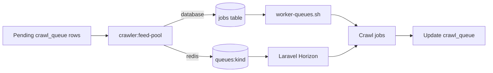

# Queue operations

## Topology

`crawl_queue` is the source of truth for crawl work. The feed-pool command claims rows only when the matching Laravel queue has capacity; workers complete the job and update the same crawl row.



The default `QUEUE_CONNECTION=database` remains supported. Its depth check counts rows in the configured `jobs` table that are not reserved and are available now. Redis mode uses `LLEN queues:<name>` through Laravel's Redis connection. Redis keys use `REDIS_PREFIX=javmeta:`; test runs use `javmeta_it:`.

## Redis and Horizon configuration

Set these values in the application environment when enabling Redis. Keep credentials in the private environment file and leave `QUEUE_CONNECTION=database` for installs that do not use Redis.

```dotenv
QUEUE_CONNECTION=redis
REDIS_HOST=host.docker.internal
REDIS_PORT=16382
REDIS_USERNAME=<scoped Redis user>
REDIS_PASSWORD=<scoped Redis password>
REDIS_PREFIX=javmeta:
REDIS_QUEUE_RETRY_AFTER=240
HORIZON_PREFIX=javmeta:horizon:
JAVMETA_WORKERS_PER_QUEUE=1
JAVMETA_QUEUE_TIMEOUT=180
JAVMETA_QUEUE_DEPTH_LIMIT=100
```

Each `config/javmeta_queues.php` name becomes a Horizon supervisor in `production`, `local`, and `testing`. Supervisors read their process count and timeout from `JAVMETA_WORKERS_PER_QUEUE` and `JAVMETA_QUEUE_TIMEOUT`. Keep the timeout below the queue connection's `retry_after`; the defaults leave a 60-second margin.

The Redis ACL identity for shared integration tests is separate from the application identity. From the Workspaces root, provision it with `scripts/docker/shared provision-javmeta-redis`; pair it with `scripts/docker/shared provision-javmeta-test` before running `docker/ci/integration-shared`. The test identity is limited to `javmeta_it:*` keys and channels. Its credentials live in the Workspaces root `.env`, not this repository.

## Backpressure

`JAVMETA_QUEUE_DEPTH_LIMIT` is the maximum ready Laravel-job backlog per crawl queue. Before claiming rows, `crawler:feed-pool` compares each queue's ready depth to that limit. A full queue emits the `pool_gated` ops event and leaves its crawl rows pending. When the queue drains, later feed-pool runs claim up to `depth_limit - ready_depth`, bounded by `--limit`.

The depth check covers ready jobs. Reserved and delayed Redis jobs do not count toward this buffer. A Redis depth-query failure stops the feed-pool command before it claims rows.

## Deploy and operate

When `QUEUE_CONNECTION=redis`, the Compose worker starts `php artisan horizon`; with the default database connection it keeps running `crawlerx-fetch-ready worker-queues`. The Redis worker healthcheck uses `php artisan horizon:status`.

Before replacing an application image, run `php artisan horizon:terminate` on the old release. Horizon stops accepting new work and waits for running jobs to finish; `fast_termination` stays disabled. Let the container supervisor start Horizon from the new release, then verify with `php artisan horizon:status`. If a job exceeds the configured timeout, its failure and retry behavior still follows Laravel's queue settings.

The dashboard route is `/horizon`. `HorizonServiceProvider` uses the same `X-Owner-Token` header and `JAVMETA_OWNER_ADMIN_TOKEN` value as `OwnerAdminGuard`. Keep the app listener private. For browser access, use a trusted loopback-only reverse proxy that injects the header for authenticated operators; do not put the token in the URL. A missing or empty token denies dashboard requests in every environment.

See the [Laravel Horizon documentation](https://laravel.com/docs/13.x/horizon) for the dashboard and worker commands.
