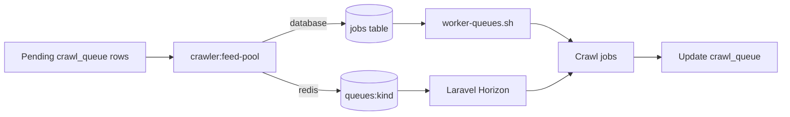

# Queue operations

## Topology

`crawl_queue` is the source of truth for crawl work. The feed-pool command claims rows only when the matching Laravel queue has capacity; workers complete the job and update the same crawl row.

The scheduler checks `crawler:feed-pool --scheduled` every five seconds. The
command reads the current `queue.feed_interval_seconds` database setting on
each run, so edits apply without restarting the scheduler. Successful dispatches
update a shared-cache heartbeat; `obs:publish-metrics` exports its age and
warning/critical state while due crawl rows remain pending. Scheduled Artisan
command failures are written to the application log.



Redis is the standard queue connection. Database queue support remains available when `QUEUE_CONNECTION=database` is explicitly selected; its depth check counts rows in the configured `jobs` table that are not reserved and are available now. Redis mode reads `LLEN queues:<name>` through Laravel's Redis connection, so feed-pool backpressure reflects the shared Redis queue rather than the database `jobs` table. Redis keys use `REDIS_PREFIX=javmeta:`; test runs use `javmeta_it:`.

A JavBTC detail without a recognizable product code uses a stable `JAVBTC-DERIVED-<SHA256>` identity from its `/r18/<slug>` path. Recognizable codes from page fields, title or URL path take precedence. A code-less page without a valid detail path still becomes a terminal `parse_failed` row with a plain reason.

## Redis and Horizon configuration

Set these infrastructure values in the private application environment. Queue
worker counts, names, limits, retry/backoff and timeouts live on Cài đặt.
Workspaces projects use the shared Redis service and project indexes generated
by `scripts/docker/shared env-project javmeta --mode live|test|wt:<id>`. Keep
Redis credentials out of tracked files. Use `QUEUE_CONNECTION=database` only
for installations that explicitly retain the database queue.

```dotenv
QUEUE_CONNECTION=redis
REDIS_HOST=<shared Redis host>
REDIS_PORT=6379
REDIS_DB=<project queue index>
REDIS_CACHE_DB=<project cache index>
REDIS_USERNAME=<shared Redis username>
REDIS_PASSWORD=<shared Redis password>
REDIS_PREFIX=javmeta:
HORIZON_PREFIX=javmeta:horizon:
```

Horizon supervises the configured queue-name list from `worker.queue_names`;
only the five crawl kinds map to `crawl_queue` rows and are claimed by the feed
pool. API usage telemetry is sent to `observability` so an OpenObserve request
does not add network latency to API responses. Its `api-observability`
supervisor is separate from the crawl and search supervisors. Each supervisor
uses the database worker count and timeout settings; `queue.retry_after_seconds`
must exceed `queue.worker_timeout`. `horizon:terminate` waits for running jobs
because `fast_termination` is disabled.
On systemd nodes, use `systemctl restart <unit-prefix>-horizon` for an immediate
reload: a clean Horizon exit does not activate the unit's `Restart=on-failure`
policy.

Movie and performer persistence dispatches a unique job to `search` after the database transaction commits. The crawl worker does not call Elasticsearch or the embedder; Horizon handles indexing with the configured database retry count and backoff. A failed job is recorded by Laravel's configured failed-job store and Horizon. `search.enabled` prevents new indexing jobs from being dispatched; queued jobs also exit without indexing while the switch is off.

Shared integration tests use the Workspaces Redis account on the project's own database indexes (`provision-project javmeta --redis`: live and test indexes) and the key prefixes `javmeta:`, `javmeta_test:` and `javmeta_wt<id>:`; the shared Redis service has one root account and no per-project Redis users or ACLs. `docker/ci/integration-shared` verifies the target with `check-project` first.

## Backpressure

API span telemetry uses deterministic sampling based on the trace ID (10% by default) and is enqueued only when the configured observability queue backlog is below `queue.observability_depth_limit` (1,000 by default). Spans are skipped when the queue is full or `QUEUE_CONNECTION=sync`, keeping OpenObserve delivery out of synchronous API requests and bounding telemetry backlog.

`queue.observability_sample_percent` adjusts sampling from 0 to 100. `queue.observability_depth_limit` bounds ready observability jobs.

`queue.depth_limit` is the maximum ready Laravel-job backlog per crawl queue. Before claiming rows, `crawler:feed-pool` compares each queue's ready depth to that limit. A full queue emits the `pool_gated` ops event and leaves its crawl rows pending. When the queue drains, later feed-pool runs claim up to `depth_limit - ready_depth`, bounded by `--limit`.

The depth check covers ready jobs. Reserved and delayed Redis jobs do not count toward this buffer. A Redis depth-query failure stops the feed-pool command before it claims rows.

Claiming a crawl row does not increment `attempts`. A worker increments it once when it starts the current claim, and the claim token prevents an older buffered job from starting after that claim has been reclaimed. Stale claims that never started return to pending with the same attempt count; stale started claims retain the existing worker-lost retry behavior. Existing claimed rows are marked started by the schema migration because the previous schema cannot distinguish buffered jobs from jobs already running.

Each stale claim reclaimed before worker start creates a `queue_reclaimed_without_start` crawl event. The count is reported for the previous five minutes by `javmeta_crawl_events_5m` with `kind=queue_reclaimed_without_start`.

## Listing freshness

`crawler:seed` runs every minute. It requeues each configured page-one movie, performer, or gallery listing after `crawl.fresh_interval_minutes` (default `60`), even when later pages in that listing chain are still pending. The existing queue row is reset in place, and the source's current request gap still delays the next attempt. Listing results continue to enqueue detail pages through the existing queue path; already known detail rows are not reset by this refresh.

When every page in a listing chain is finished, the loop still restarts page one after `crawl.loop_pause_seconds` (default `300`). This end-of-chain pause remains independent of the page-one freshness interval.

## Incomplete movie recrawls

`crawler:recrawl-incomplete` uses the database `crawl.recrawl_days` (7 days by default) and only selects movies below `crawl.recrawl_min_tier`. `crawl.recrawl_max` defaults to 3 consecutive successful recrawls without a newly populated movie field. New movie data resets the count; at the limit, the movie is marked `complete_as_possible` and later recrawl runs skip it.

Use `php artisan crawler:recrawl-stopped` to list stopped movies by code and no-progress rounds. `php artisan crawler:recrawl-stopped --reset` clears the stopped status and counter for all stopped movies so they can be considered by a later recrawl run.

## Deploy and operate

The Compose worker starts `php artisan horizon` when `QUEUE_CONNECTION=redis` (the default); with `QUEUE_CONNECTION=database` it keeps running `crawlerx-fetch-ready worker-queues`. The Redis worker healthcheck uses `php artisan horizon:status`.

Before replacing an application image, run `php artisan horizon:terminate` on the old release. Horizon stops accepting new work and waits for running jobs to finish; `fast_termination` stays disabled. Let the container supervisor start Horizon from the new release, then verify with `php artisan horizon:status`. If a job exceeds the configured timeout, its failure and retry behavior still follows Laravel's queue settings.

The dashboard route is `/horizon`. `HorizonServiceProvider` uses the owner token in the database setting `ui_security.owner_admin_token`, shared with `OwnerAdminGuard`. Keep the app listener private. For browser access, use a trusted loopback-only reverse proxy that injects the header for authenticated operators; do not put the token in the URL. A missing or empty token denies dashboard requests in every environment.

See the [Laravel Horizon documentation](https://laravel.com/docs/13.x/horizon) for the dashboard and worker commands.


## Fairness between sources

`CrawlQueueService::claimNext` skips a source that already has `queue.per_source_inflight` (default 4) claimed, unfinished
rows of the same kind, so one source with thousands of older rows cannot fill the worker queue and starve the others.
Parallelism comes from `queue.workers_per_queue` and its lane, queue and node overrides; each source is still limited by its own
throttle gap.


## Request pacing and adaptive gap

The gap between requests of one source (`sources.gap_seconds_current`, between its min and max) is enforced when the
feed pool hands out work: a source may have at most `floor(queue.pacing_horizon_seconds / gap)` rows waiting (default
horizon 60 seconds), and its jobs are delayed so that they start one gap apart. Rows that are still claimed from an
earlier run count against the budget. The gap adapts to the answers of the site: rate limits, blocks and challenges
double it up to `queue.gap_blocked_max_seconds` (default 600); timeouts and network errors raise it by half up to the
source maximum; parse and not-found errors do not change it; every success lowers it by 10 percent of the distance to
its minimum. The current gap is in `crawler:sources`, the status API and the metric `javmeta_source_gap_seconds`.


## Direct and browser lanes

`crawl.lanes_enabled` (Settings UI, default true) separates the five crawl kinds into
`listing`, `detail`, `performer_listing`, `performer_detail`, `gallery` and their
`browser_` counterparts. Search indexes application data rather than fetching a
source; `search` and `observability` keep their existing queues. Every queue has
its own Horizon supervisor and wait metric; deployment readiness checks both crawl
lanes, including while the split is disabled so already queued browser jobs drain.

The static `queue.browser_sources` list is the default browser lane. The complete
04:00 `crawler:source-health` run also aggregates the preceding 24 hours of
`crawl_fetch_attempts` (excluding skipped attempts). At least 40 attempts and at
least 25% FlareSolverr/Playwright attempts assign a source to browser. The two
thresholds are `crawl.lane_min_attempts` and `crawl.lane_browser_percent`. The
snapshot is stored in `sources.browser_lane`; insufficient or expired history
clears a computed decision. Runtime-escalating sources such as heyzo therefore
join the browser cap after classification without editing the static list.
A first unseen escalation can occur before the next daily classification; pin a
known browser-dependent source immediately when operational evidence requires it.

Manual `crawl.lane_browser_pins` and `crawl.lane_direct_pins` (one slug per line)
override computed/static assignment. If a slug appears in both lists, direct wins;
remove the direct pin to switch it to browser. Current effective lanes appear in
`crawler:sources [--json]`, `/api/v1/status/sources`, MCP crawl status and Crawl &
sources. Settings are database-backed and Vietnamese-labelled in Cài đặt.

`queue.workers_per_queue`, `worker.direct_workers_per_queue` and
`worker.browser_workers_per_queue` control workers; queue and node overrides
take precedence. Horizon reads them at startup and `horizon:reconcile-workers`
applies changes automatically. Each lane gets its own feed-pool dispatch budget (the
`--limit`/`queue.feed_pool_limit` value per lane), so a full direct backlog cannot
consume the browser dispatch budget. Queue depth limits are independent:
`queue.depth_limit` and `queue.browser_depth_limit`. Pacing and per-source
inflight limits remain shared across the source's work. `queue.browser_inflight`
is a fleet-wide claimed-row cap across every browser source and crawl kind,
including computed runtime-escalating sources and legacy claims on old queues.
PostgreSQL serializes claim transactions with an advisory transaction lock so
concurrent feeders cannot oversubscribe that cap.
Claims retain their original lane even after a source is pinned or reclassified
as direct, so existing browser work still consumes the cap. Legacy claims without
a lane are included through source classification. A separate PostgreSQL session
lock covers the complete depth-check/dispatch cycle; competing feeders skip the
run until the active feeder releases it. The database-mode worker also consumes
all five browser queues using the same database worker layout. Migrated
`worker.queue_names` values retain configured queue names; the normal default
includes search and observability queues.

### Two-node rollout and rollback

1. Pause the scheduler's feed-pool invocation and allow existing workers to finish
   active jobs. Keep only one scheduler in the fleet.
2. Apply the additive `sources.browser_lane` and `crawl_queue.claimed_lane` migrations on the scheduler node.
   Install the release on both nodes; refresh config caches, then gracefully
   restart Horizon on worker nodes first, followed by the scheduler node. Verify
   all direct and browser supervisors are running before resuming dispatch.
3. Resume the scheduler. Run the existing complete `crawler:source-health` check
   to seed classification now, or wait for 04:00; static/manual assignment works
   immediately. Check source lanes, queue depths and Horizon wait metrics.
4. Existing queued jobs retain their original queue name and claim token. Both
   queue sets remain supervised. No queue payloads or claimed rows are rewritten.
   Stale unstarted claims return to pending without spending an attempt; a new
   claim token makes a delayed old job a no-op. Started rows retain the existing
   stale timeout/retry policy. Never manually duplicate or flush queued jobs.
5. To disable splitting, set `crawl.lanes_enabled=false` in Cài đặt. New claims
   use old queue names; leave browser supervisors running until all old browser
   ready/delayed/reserved jobs drain. Pause dispatch and drain both sets before
   reverting code; keep the additive column until all new code has stopped.

Additional worker-only nodes use the same two worker-count variables and queue
supervisors. Browser-service capacity remains shared across the whole fleet;
increasing worker nodes does not increase that capacity.

### Product-code recovery (JOOXCR-283)

The rejection was in javmeta's `SiteCodeCanonicalizer` / `NormalizedCode`, not a
CrawlerX parse failure: JavBTC's specialized normalizer reports `parse_failed`
when no DVD code is found. CrawlerX already supplies a title and external ID.
No CrawlerX dependency update is needed for this fix.

Code rules (existing recognizable DVD codes keep their current identity):

| Source | Product identity |
| --- | --- |
| ffjav | Preserve `10musume-052425_01` as `10MUSUME-052425_01`; both the date and sequence belong to the identity. |
| 141jav | Accept the single-letter product number `C2897`, displayed as `C-2897`. |
| tokyohot | Keep numeric/N IDs unchanged; scene products use the **entire** slug, e.g. `TOKYOHOT-SLUG-JAPANESE_INVASION_2_AMERICA_SC4`. Never use `Sc4` alone: different movies share scene numbers. |
| javbtc | Prefer a recognizable product number from page fields, title or URL. |

Only these four sources may fall back to `<SOURCE>-DERIVED-<SHA256>` when no
product candidate is usable. The path must match `/r18/<slug>` for javbtc,
`/torrent/<slug>` for ffjav/141jav, or `/product/<slug>` for tokyohot.
SHA256 covers the complete case-sensitive URL path
without a trailing slash; query parameters, fragments and host aliases do not
change it. For these path-based sources, query parameters and fragments are
also excluded from product-code extraction, including typed codes inferred
by CrawlerX from tracking parameters. Other sources keep their query-ID rules.
The reserved source namespace prevents cross-source collisions.
Titles never enter the hash. Re-crawling the same page updates its existing
movie through the indexed `code_normalized` identity. Missing titles still fail.
Other sources retain their previous rejection behavior.

After the fix has been reviewed and deployed by the operator, inspect the
recovery scope first (these commands were **not** run against production):

```bash
php artisan crawler:requeue-product-codes --dry-run
php artisan crawler:requeue-product-codes
```

The command prints counts separately for javbtc, ffjav, tokyohot and 141jav.
Only failed **detail** rows with `parse_failed` or `normalization_failed` are
reset to pending; attempts, errors, timestamps and worker claims are cleared.
This is an error-code recovery scope: it also retries unrelated parse failures
and missing-title normalization failures with those same error codes; those
may fail again if their page problem remains. The dry-run reports all of them.
Other sources, error codes, active rows and completed rows are untouched.
Repeated execution is safe because pending rows no longer match. It changes
queue state only; the existing scheduler performs the actual crawl.
