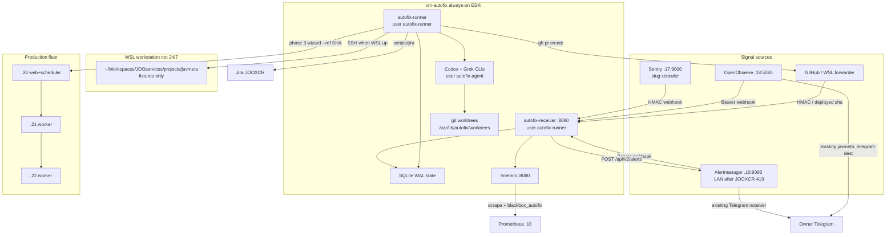
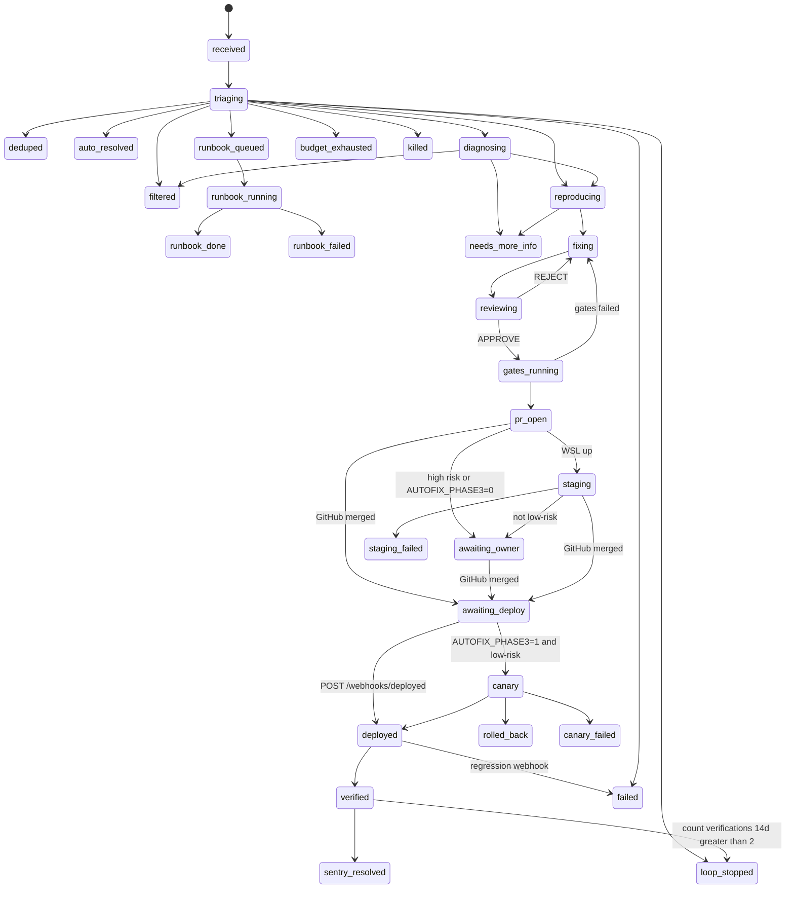
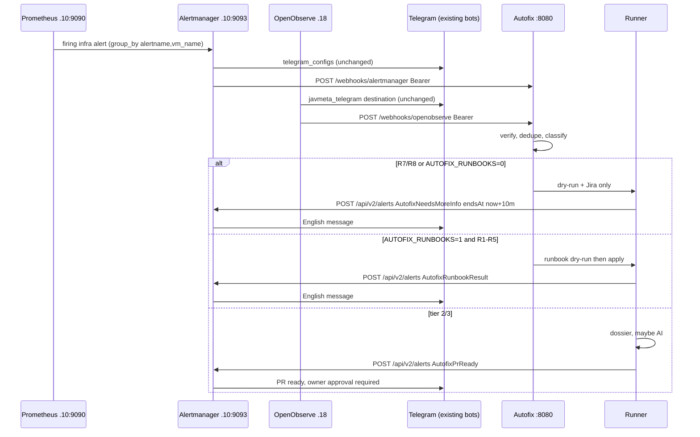

# Autofix: autonomous incident-fix system (JOOXCR-404)

Status: **PROPOSED**
Date: 2026-11-06
Ticket: JOOXCR-404
Author: Grok (design), owner approval pending
Intended path: `docs/decisions/autofix.md`
Worktree: `JOOXCR-404-autofix-design` (from JOOXCR-373-readiness, HEAD `1b667d9`)
Agents: Codex (`gpt-6-luna`, reasoning effort `xhigh`) and Grok only. **OpenCode is forbidden** (owner 2026-11-06).

This is a full technical design, not a one-page ADR. An engineer who has not seen the conversation must be able to implement from this document.

---

## Overview

XCrawler already emits two classes of operational signal: Sentry issue events from the three production nodes (code errors) and metric anomalies from Prometheus/Alertmanager (infrastructure) plus OpenObserve (application metrics in `deploy/observability/alerts/*.json`). Nothing in the application currently *reads* those signals and changes the system (`result-audit-sa.md` SA-20). The owner wants the fleet to run without routine human participation: ingest an incident, reproduce it with a failing test, fix it, open a PR, optionally stage on WSL, and — only for a narrow low-risk class — canary-deploy with automatic rollback.

Autofix is a **separate, always-on control-plane service** on a dedicated LAN VM. It is event-driven (HTTP webhooks only; no work-polling scheduler). Deterministic code does ingest, authentication, dedupe, tiering, rate limiting, and dossier construction. AI agents receive a compact, policy-scrubbed incident dossier and operate only inside a per-task git worktree, as unix user `autofix-agent` (no deploy keys, no GitHub/Sentry/AM tokens). A fix is accepted only when a real test failed on `release_sha_seen` (or its merge-base with `origin/develop`) and passes on the new SHA, local gates pass, **changed-line** coverage is ≥ 85% (diff-cover) plus the existing global 90% gate, and the *other* AI has approved the diff. Production deploy reuses the native wizard (`deploy/production.sh` / `deploy/lib/install.sh`) with the same `--ref` SHA on `.20` then `.21` then `.22`, wizard-equivalent rollback (symlink + env + units), `AUTOFIX_ENABLED=0`, `AUTOFIX_PHASE3=0`, and `AUTOFIX_RUNBOOKS=0` until the owner flips each flag.

Autofix does **not** replace SA-01 restore work, SA-02 connection budget, or SA-04 pacer correctness. It fail-closes on anything that would paper over missing backups, touch schema, secrets, infra, or ESXi.

---

## Background & Motivation

### Current state (audit baseline + owner-stated later facts)

The 2026-11-05 architecture audit (`/home/joos/Workspaces/.tmp/codex/result-audit-sa.md`) measured:

| Node | Role | Notes |
|---|---|---|
| `192.168.10.20` | web + the only scheduler + Horizon | 4 vCPU / 15 GiB |
| `192.168.10.21`, `.22` | Horizon workers | 4 vCPU / 15 GiB each |
| `.12` PG, `.13` Mongo, `.14` Redis, `.15` ES | data | single instances |
| `.4` HAProxy | gatekeeper | one backend for xcrawler-web |
| `.19` | browser (FlareSolverr 8191, Playwright 3000), SonarQube, Infisical | |
| `.18` OpenObserve, `.17` Sentry, `.16` RabbitMQ, `.10` Prometheus/Alertmanager | shared lab | |

SA-08: crawl/business alerts (`alerts:evaluate`, `crawler:watchdog`, `obs:publish-metrics`, `telegram:poll`) run inside `schedule:work` on `.20`. A stopped scheduler looks like a quiet system. SA-20: nothing in this codebase reads an error and changes the system to fix it; the audit recommended **not** adding an autonomous fixer until restore, external alerts, and a connection budget existed.

Owner-stated updates after that audit (**not in this worktree**; live VMs / memory files, do not treat as repo-verified tunables):

- Sentry DSN is set on all three app nodes; project slug `xcrawler` on `.17` (`VM_SENTRY_HOST`). Events arrive with full stack traces (owner 2026-11-05). Numeric project id is **not** hard-coded in autofix; fingerprints use the issue id from the webhook payload.
- JOOXCR-390 (in this worktree) writes the **full commit SHA** to `SENTRY_RELEASE` in the native installer (`deploy/lib/install.sh` sets `answers[SENTRY_RELEASE]="$commit"`) and Compose (`deploy/repository.sh`). `config/sentry.php` sets `server_name` from `JAVMETA_NODE_NAME`.
- JOOXCR-388 (in this worktree): Prometheus + Alertmanager on `.10` page Telegram. Alertmanager is the home for **infrastructure** alerts; OpenObserve (`deploy/observability/alerts/*.json`) is the home for **application metric** alerts; the XCrawler app remains the home for **crawl business** evaluator alerts (`feedback-production-extreme-care.md`).
- PostgreSQL `.12` `max_connections` and Redis `.14` `maxmemory` were changed on the live VMs (owner 2026-11-06). The audit measured 150 / `maxmemory 0`. `deploy/production/README.md` still says role limit 60 and `max_connections` 150. Autofix does **not** depend on those tunables being correct.
- Backups are handled by the owner on the NAS (owner 2026-11-06). Do not raise SA-01 as an autofix work item. `backup.monitoring_enabled` / JOOXCR-397 is **not in this worktree**; autofix does not match `backup.*` Prometheus rules that are absent from `ops/monitoring/prometheus/rules/`.

WSL is staging, not 24/7, and shares the WAN IP with production. Staging must not crawl real sites by default (`docs/03-operations/sample-dataset.md`, `feedback-reproduce-before-fix.md`).

### Pain points this design attacks

1. Owner still has to triage Sentry and Alertmanager, reproduce, patch, gate, PR, and deploy.
2. SA-08 remains true for *application* Telegram alerts; infrastructure paging already survives a dead scheduler via `.10`. Autofix must also survive a dead `.20`.
3. AI quota is scarce (two Codex Plus accounts, Grok balance historically exhausted). Polling Sentry would waste it.
4. Cloud-AI policy forbids sending catalog titles, images, audio, magnets, cookies, or request bodies to cloud models (`docs/decisions/cloud-ai-policy-decision.md`).

### How this addresses SA-20 without papering over it

SA-20's recommendation stands as a **scope constraint**, not a veto of this ticket:

- Autofix **never** restores Postgres/Mongo/ES and never claims to.
- Autofix **never** auto-runs migrations (`deploy/lib/install.sh` rollback already documents "Database migrations are NOT reversed").
- Autofix **never** restarts postgres, mongo, redis, elasticsearch, haproxy, nginx, php-fpm, or xcrawler units.
- `AUTOFIX_ENABLED=0`, `AUTOFIX_PHASE3=0`, and `AUTOFIX_RUNBOOKS=0` until the owner flips each flag. R7/R8 (page / Jira only) may run when ingest is on; reclaim, silence, source-toggle, and lock-file deletes do not.
- Missing-backup conditions are not "fixed" by code changes; they are ignored or `needs_more_info`.
- Connection-budget and pacer bugs may be picked up **only** if they appear as Sentry/OpenObserve/Alertmanager signals, and only through the reproduction contract.
- Canary never passes `--skip-backup-check` (wizard backup gate stays; JOOXCR-414 acceptance test).

---

## Goals & Non-Goals

### Goals

- Ingest Sentry, Alertmanager, and OpenObserve events over authenticated LAN webhooks, plus GitHub `pull_request` merged and operator `POST /webhooks/deployed {sha}`. No polling loop that creates work.
- Dedupe, rate-limit, budget-cap, and loop-stop in code before any AI token is spent.
- Reproduce every accepted code fix with a test that fails on `release_sha_seen` (or merge-base with `origin/develop`) and passes on the new SHA.
- Open a PR against `develop` for owner approval (phase 1, always).
- When WSL is up, deploy the PR to staging without enabling real crawl (phase 2, best-effort; not a predecessor of phase 3).
- Auto-canary to production **only** for low-risk merged SHAs when `AUTOFIX_PHASE3=1`, with the same SHA on `.20`/`.21`/`.22` and wizard-equivalent rollback. Phase 2 skip does not block canary.
- Notify in English via the **existing** Alertmanager Telegram bot (JOOXCR-388 path).
- Leave an audit trail in Jira (`JOOXCR`) and git (PR + commits). Full dossiers stay on the VM (0600), not in the public repo.

### Non-goals

- Not a replacement for SA-01 backups, SA-02 connection budget, SA-04 pacer, SA-06 SPOFs.
- Not OpenCode.
- Not a polling AI agent and not a cron that lists Sentry issues.
- Not allowed to touch ESXi, enrol WSL as a node, crawl real sites from staging by default, force-push, or bypass hooks (`--no-verify`).
- Not allowed to restart main production services (postgres, mongo, redis, elasticsearch, haproxy, nginx, php-fpm, xcrawler including `xcrawler-horizon` and `xcrawler-scheduler`).
- Not a second Telegram bot.
- Not an in-app Laravel feature on `.20`.
- Implementation is later tickets (JOOXCR-405+). This ticket is design only.

---

## Key Decisions

| # | Decision | Rationale |
|---|---|---|
| D1 | Dedicated always-on Ubuntu 24.04 VM `vm-autofix`, **4 vCPU / 8 GiB RAM / 80 GiB disk**, proposed IP `192.168.10.23` (**unverified**; owner confirms). Receiver + SQLite queue + runner + `/metrics` all live here. | WSL is not 24/7; AI CLI logins must live where the runner is. 2 vCPU / 4 GiB cannot host `docker/ci/run composer test:coverage`. |
| D2 | **Do not reuse `.10`** for receiver or runner. Alertmanager on `.10` gains a LAN bind + nftables, a `webhook_configs` target, scrape/blackbox jobs, and inhibit rules. | `.10` is production Prometheus+Alertmanager. AI credentials, git worktrees, and Docker CI on it expand blast radius and can starve alerting (SA-08 lesson applied to the monitor itself). |
| D3 | Receiver is a **standalone PHP 8.5 control-plane** under `ops/autofix/` in this repo. It is **not** a Laravel route on `.20`. Owner Laravel layering (FormRequest → Controller → Service → `jooservices/laravel-repository` → Model) applies **only** to XCrawler `app/`. `ops/autofix` is a sealed Composer project with its own PHPUnit/Pint/PHPStan and **must not autoload `app/`**. | SA-08: if Laravel/scheduler is down, autofix must still receive. Putting it in XCrawler also couples the fixer to the thing it fixes and would require production DB credentials on a new attack surface. |
| D4 | Durable state is **SQLite WAL** on the autofix VM (`/var/lib/autofix/state.sqlite`, 0600). Not production Redis `.14`, not Mongo `.13`. | Single-writer control plane; no extra SPOF on the data VMs; backup is `sqlite3 .backup` to the same volume. |
| D5 | Webhooks are **HTTP :8080 on the LAN** with HMAC/bearer + nftables source allowlist + 300 s replay window. TLS is a later hardening, not v1. Do not start `javmeta-monitoring` compose on this VM without remapping cadvisor's container port 8080. Laravel `alerts.webhook_url` is https-only (`config/javmeta_settings.php`) so it is **not** used in v1. | Existing Sentry (`VM_SENTRY_HOST:9000`) and OpenObserve (`VM_OPENOBSERVE_HOST:5080`) are HTTP on this LAN. A self-signed cert without a homelab PKI is theatre. nftables + signatures are the real control. |
| D6 | Telegram via **Alertmanager alert ingestion** (`POST` to Alertmanager `/api/v2/alerts` on `192.168.10.10:9093` after JOOXCR-419 binds AM off loopback). Not a second bot and not a direct Telegram call from autofix. | JOOXCR-388 B6 already proved this path. One template (`ops/monitoring/alertmanager/telegram.tmpl`), one secret pair (`bot_token_file` / `chat_id_file`). SSH-curl to AM loopback and a reverse-proxy on `.10` are rejected. |
| D7 | Codex writes most backend; Grok writes runner/staging/e2e. **Second AI must APPROVE the diff.** If the reviewer has no quota, the incident waits (`budget_exhausted`), it is not skipped. | Owner 2026-11-06: Codex + Grok only. Reproduction-before-fix and production-extreme-care require a second pair of eyes. |
| D8 | Defaults: `AUTOFIX_ENABLED=0`, `AUTOFIX_PHASE3=0`, `AUTOFIX_RUNBOOKS=0`. Presence of `/etc/autofix/disabled` also stops work. | Owner is not present; a first-run bug must not ship. Enabling each flag is an explicit file/env change on the VM plus a Jira/Telegram note. Ingest with `AUTOFIX_ENABLED=1` still does not apply mutating runbooks. |
| D9 | Dossiers live at `/var/lib/autofix/incidents/<id>/` mode 0600. Jira gets a **redacted** comment. The public repo does **not** grow `artifacts/autofix/*.md` with stack traces. | Stack traces are OK for the AI (cloud-AI policy) but the GitHub repo is public. |
| D10 | Phase 3 never runs migrations, never deploys a diff that touches auth/secrets/infra/data, never uses `--skip-backup-check` or `--no-verify`. | `install.sh` rollback cannot reverse schema. |
| D11 | Sentry issues are resolved **only after** the SHA is deployed to all three nodes **and** a verification window sees no regression. Use Sentry status `resolvedInNextRelease` at deploy, then `resolved` after verification. | Owner: Sentry must go to zero, one by one; resolve only after deploy + verification (JOOXCR-401 related). |
| D12 | Loop stop: `count(*)` from `incident_verifications` where `verified_at > now()-14d` for that fingerprint is **> 2** → `loop_stopped`, page the owner, no further AI. | A monotonic `verified_count_14d` would never decay. |
| D13 | Bind Alertmanager `--web.listen-address=192.168.10.10:9093` on `.10` (LAN IP, same style as JOOXCR-388 blackbox `:9115`), plus nftables allowlist (autofix VM, WSL `192.168.2.0/24`, and `.10` itself). **Not** `0.0.0.0`. Move Prometheus `alerting.alertmanagers` and the `alertmanager` scrape job from `127.0.0.1:9093` to `192.168.10.10:9093` in the same change so scrape still works. Production-extreme-care: backup live unit/file, `amtool check-config`, SIGHUP only, never restart AM. Ticket JOOXCR-419, applied with JOOXCR-416. | Today AM listens on `127.0.0.1:9093`. Autofix cannot reach that loopback. `0.0.0.0` would also bind docker/bridge addresses and leave nftables as the only filter. SSH-curl-loopback and a reverse-proxy on `.10` remain rejected. |
| D14 | OpenObserve is a **required** event-driven source: `POST /webhooks/openobserve` (bearer + nftables from `.18`). Keep existing OO Telegram destinations (`javmeta_telegram`, `javmeta_telegram_critical`). Do not poll the OO query API. | Owner listed Prometheus/Alertmanager/**OpenObserve** as the metric-anomaly path. AM on `.10` is mostly infra (R7 page-only). App metric alerts live in `deploy/observability/alerts/*.json`. |
| D15 | Merge and deploy are inbound events: `POST /webhooks/github` (HMAC `X-Hub-Signature-256`) for `pull_request` merged, and `POST /webhooks/deployed {sha}` after a manual wizard run. The 30-minute verification window is a local SQLite `due_at` timer on the runner, not a Sentry/GitHub poll. Regression is a **new** Sentry webhook for that issue whose `release` equals the deployed SHA. | With `AUTOFIX_PHASE3=0` the owner merges and deploys; without these webhooks Sentry never reaches `resolved`. |
| D16 | Two unix users: `autofix-agent` (Codex/Grok CLIs, worktrees, no SSH keys, no `/etc/autofix`, no `gh` token) vs `autofix-runner` (deploy key, GitHub/Sentry/AM/OO tokens, `gh pr create`). Grok writer: `--sandbox workspace --permission-mode bypassPermissions`. Grok reviewer: `--sandbox read-only --permission-mode bypassPermissions --disallowed-tools run_terminal_command`. Codex: `-s workspace-write` **without** `sandbox_workspace_write.network_access`. A `git` wrapper on the agent PATH rejects `--force`, `--no-verify`, and `core.hooksPath`. LowRisk diff scan runs **before** `gh pr create`. | Grok has no `workspace-write` profile (`off\|workspace\|read-only\|strict\|devbox`). One user holding secrets + the model is prompt-only isolation. |
| D17 | Reproduce on `release_sha_seen` (production `SENTRY_RELEASE`), or `git merge-base release_sha_seen origin/develop` if that SHA is absent. Implement on a branch from `origin/develop`. Coverage: existing global `composer coverage:check` (≥ 90%) **plus** ≥ 85% of **changed lines** (diff-cover), not 85% of the whole touched file. | Develop may not contain the production bug. Whole-file 85% fails on large under-covered files (`phpunit.xml` already excludes `app/Console/Commands`). |

---

## Proposed Design

### 1. Where each component runs



#### 1.1 Dedicated VM (adopted)

| Item | Value |
|---|---|
| Name | `vm-autofix` / hostname `autofix` |
| OS | Ubuntu 24.04 |
| Size | **4 vCPU / 8 GiB RAM / 80 GiB disk** |
| Network | `192.168.10.0/24`, **not** on the internet, **not** behind Cloudflare |
| IP | Candidate **`192.168.10.23`**, **unverified live**. Occupied in this repo (`VM_*_HOST` keys and `ops/monitoring/prometheus/prometheus.yml`): `.4 .10 .11 .12 .13 .14 .15 .16 .17 .18 .19 .20 .21 .22`. `.1` is the typical gateway (**unverified**). ESXi guests that are not scraped (NAS, hypervisor, other lab VMs) could still hold `.23`. **Owner must confirm `.23` is free and snapshot the VM.** Do not bake `.23` into nftables or Alertmanager URLs until that snapshot exists. If `.23` collides, keep the name `vm-autofix` and pick another unused octet. |
| Users | **`autofix-runner`**: receiver, runner, deploy key, tokens, docker. **`autofix-agent`**: Codex/Grok CLIs and worktrees only (no sudo, no docker group, no `/etc/autofix`, no `gh` token, no SSH keys to `.20`). Both nologin except via `joos` sudo. Shared group `autofix` with 0750 on `/var/lib/autofix/worktrees` and 0700 on `/var/lib/autofix/incidents` (runner-only). |
| Docker | Engine for `docker/ci` gates, run as `autofix-runner`. Env: `JAVMETA_CI_DOCKER=1`, `JAVMETA_CI_SKIP_BUILD=1` after provision-time `docker build -t javmeta-ci:local -f docker/ci/Dockerfile docker/ci`, `DOCKER_CONFIG=/var/lib/autofix/docker-config` (0600, runner). Never overlap an agent process with `composer test:coverage`. Do not start `javmeta-monitoring` compose on this VM (cadvisor publishes container port 8080; `docs/03-operations/monitoring.md`). |

**Why 4/8/80, not 2/2 or 2/4.** `docs/03-operations/ci.md` / `docker/ci/run` on a host without the Workspaces shared runtime **exits 2** unless `JAVMETA_CI_DOCKER=1`. GitHub-hosted runs of 1,265–1,357 tests take 190–235 s on ~7 GiB; `phpunit.xml` is sequential with `memory_limit=512M`; `composer lint:phpstan` is `--memory-limit=512M`. Sequential Codex-then-gates on 8 GiB works; concurrent receiver + Docker **build** of `php:8.5.11-cli-bookworm` + pcov + a Codex process does not. Preload `javmeta-ci:local` on the VM snapshot and never overlap agent + coverage. JOOXCR-422 acceptance: `JAVMETA_CI_DOCKER=1 JAVMETA_CI_SKIP_BUILD=1 docker/ci/run composer test:coverage` completes on the 8 GiB VM, or gates offload to WSL when RSS exceeds 5 GiB. 80 GiB holds OS, the preloaded CI image (~8–12 GiB), worktrees, incident logs, and SQLite backups.

**Split rejected:** receiver-always-on on a 2 vCPU / 2 GiB micro-VM and runner-on-WSL. Phase 1 (analysis + PR) must work when WSL is off. AI CLI sessions (`~/.codex-jenny`, `~/.codex`, `~/.grok`) must live on the runner host; splitting them means copying refresh tokens or SSH-forwarding CLIs, both worse.

#### 1.2 `.10` alternative (evaluated and rejected)

| Option | Verdict |
|---|---|
| Run receiver + runner on `.10` | **Reject.** Production alerting host. Docker CI and worktrees compete with Prometheus/Loki. Compromised AI credential = compromised Alertmanager secrets on the same box. |
| Receiver-only sidecar on `.10`, runner on `vm-autofix` | **Reject.** Saves almost nothing (the receiver is tiny) and still puts a new HTTP surface next to Alertmanager. Keep `.10` config changes to one `webhook_configs` + scrape job. |
| Receiver inside Laravel on `.20` | **Reject.** SA-08. Also `alerts.webhook_url` (`app/Services/Alerts/WebhookAlertChannel.php`) is an *outbound* crawl-alert channel, not an inbound incident bus. |

`.10` **does** gain:

1. Alertmanager listen-address change (JOOXCR-419) so autofix can `POST /api/v2/alerts` and `/api/v2/silences` without SSH-curl.
2. A child route + `webhook_configs` pointing at `vm-autofix:8080/webhooks/alertmanager` — **not applied live until the receiver is up** (JOOXCR-416 after 418).
3. A Prometheus scrape job `autofix` and blackbox job `blackbox_autofix` of `/health` (JOOXCR-388 `relabel_configs` style).
4. Alert rules for receiver-down / queue-stuck / runner-silent, plus inhibit of `PrometheusAlertmanagerNotificationFailing` while `AutofixReceiverDown` fires.

#### 1.3 Ports (LAN-only)

nftables on `vm-autofix` default deny inbound. Allow:

| Port | Proto | Sources | Service |
|---|---|---|---|
| 22 | tcp | WSL `192.168.2.0/24` (workstation is `192.168.2.10` per `staging-runbook.md`) and jump/gatekeeper if that is how `joos` SSHes today | sshd |
| 8080 | tcp | `.10` (Alertmanager + Prometheus + blackbox), `.17` (Sentry), `.18` (OpenObserve), `192.168.2.0/24` (operator / GitHub-forwarder / deployed), optionally `.4` if a later host ACL forwards GitHub | receiver: webhooks, `/health`, `/metrics` |
| 9100 | tcp | `.10` only | node_exporter |

Do **not** expose 9000, 5080, 5432, 6379, 9200, 9090, 9093. Do not also bind cadvisor on 8080.

Outbound from `vm-autofix` as **`autofix-runner` only** (nftables allowlist, not "any"):

- `.17:9000` Sentry API (issue fetch, resolve)
- `.10:9093` Alertmanager API (emit Telegram-bound alerts; **after** JOOXCR-419 LAN bind)
- `.10:9090` optional PromQL read for AM-infra dossiers
- GitHub `https://api.github.com` and `https://github.com` (git + `gh`)
- Jira via the existing `scripts/jira` adapter (Atlassian cloud)
- SSH to `.20`/`.21`/`.22` for phase-3 deploy using the **same sudoers humans already use** to run `deploy/production.sh` as `SERVICE_USER` (`xcrawler`). Key lives at `/var/lib/autofix/.ssh/id_ed25519` (runner, 0600).
- SSH to WSL `192.168.2.10` for phase 2; skip if down
- Codex/Grok vendor APIs (CLIs run as `autofix-agent`; network for Codex is off, Grok reviewer has no child network under `read-only`)

No egress to source sites. The agent never SSHs. `autofix-agent` has no outbound nftables exceptions except the vendor API destinations required by the CLIs.

On `.10`, nftables for Alertmanager `:9093` after the LAN bind (`192.168.10.10:9093`, not `0.0.0.0`): allow `192.168.10.10` (Prometheus scrape and `alerting.alertmanagers` on the same host), the autofix VM IP, and WSL `192.168.2.0/24` (amtool). Deny the rest of the LAN. JOOXCR-419 also rewrites `ops/monitoring/prometheus/prometheus.yml` `alerting.alertmanagers` and `job_name: alertmanager` from `127.0.0.1:9093` to `192.168.10.10:9093` (loopback will not connect once AM leaves `127.0.0.1`).

#### 1.4 Component processes on the VM

| systemd unit | User | Role | Restart |
|---|---|---|---|
| `autofix-receiver.service` | `autofix-runner` | PHP 8.5 bound to the VM LAN IP:8080 (not `0.0.0.0`). Exports `autofix_heartbeat_timestamp_seconds` (HTTP process liveness). | `on-failure`, 5s |
| `autofix-runner.service` | `autofix-runner` | Dequeue → classify → maybe `sudo -u autofix-agent` launch. Exports `autofix_last_runner_ok_timestamp_seconds` by updating SQLite; receiver reads it for `/metrics`. | `on-failure`, 5s |
| `node_exporter` | root | stock | |

No separate heartbeat timer. Receiver liveness is `autofix_heartbeat_timestamp_seconds` (updated on each `/metrics` scrape handler). Runner liveness is `autofix_last_runner_ok_timestamp_seconds` (updated only by the runner loop). A wedged runner with a live PHP server still trips `AutofixRunnerSilent`.

Receiver and runner share SQLite with `busy_timeout=5000` and WAL. One runner process (never concurrent agents in v1). Never overlap agent + `test:coverage`.

### 2. Language / stack for the receiver

**Choice: PHP 8.5, standalone Composer project `ops/autofix/`, PHPUnit, Pint, PHPStan. Not Laravel. Not Node. Not Python.**

| Option | Pros | Cons | Verdict |
|---|---|---|---|
| Laravel routes on `.20` | Native layering, existing tests | Dies with the app/scheduler (SA-08); fixer lives in the patient; needs production APP_KEY | **Reject** |
| Full Laravel app on `vm-autofix` | FormRequest → Service → Repository | Pulls Horizon, Eloquent, Mongo, the catalog; huge attack surface; would tempt someone to point it at production DB | **Reject** |
| Node 22 + Fastify | Fine HTTP | Not in `docker/ci/Dockerfile`; second lint/test toolchain | **Reject** |
| Python 3 + stdlib `http.server` | Tiny | Same toolchain split; owner PHP standards would not apply | **Reject** |
| **PHP 8.5 + Slim-or-front-controller + SQLite** | Same `docker/ci` image, Pint/PHPStan/PHPUnit, no Laravel container, no production DB | Must write a small framework-less app (~2–4k LOC) | **Adopt** |

Layout (all new, none of this is Laravel-app code, so FormRequest layering does **not** apply):

```text
ops/autofix/
  composer.json          # php ^8.5, phpunit ^13, phpstan, pint
  public/index.php       # front controller
  src/
    Http/Router.php
    Http/SentryWebhookHandler.php
    Http/AlertmanagerWebhookHandler.php
    Security/SentryHmac.php
    Security/BearerToken.php
    Security/ReplayCache.php
    Security/Scrubber.php
    Queue/IncidentStore.php      # SQLite
    Queue/StateMachine.php
    Queue/Dedupe.php
    Triage/Classifier.php
    Triage/LowRisk.php
    Dossier/DossierBuilder.php
    Jira/JiraAudit.php           # wraps scripts/jira
    Sentry/SentryApi.php
    Notify/AlertmanagerClient.php
    Metrics/Exporter.php
  bin/receiver
  bin/runner
  tests/
  phpunit.xml
  phpstan.neon
```

CI: a new job **or** a path filter in `.github/workflows/ci.yml` that runs `ops/autofix` tests inside the existing `docker/ci` image (`php:8.5.11-cli-bookworm`). Local: `docker/ci/run composer --working-dir=ops/autofix test`.

Owner Laravel layering applies only to XCrawler `app/`; `ops/autofix` is a sealed Composer project with its own PHPUnit/Pint/PHPStan and must not autoload `app/`. Path-filter CI job as specified. If a future Command Center page must *display* autofix status inside XCrawler `/ops`, that page **would** follow owner Laravel convention (`docs/decisions/node-enrollment.md`): FormRequest → Controller → Service → `jooservices/laravel-repository` → Model, DTOs, one subscriber — and it would call autofix over HTTP, not share SQLite. **v1 has no such page.** Status is `/health`, `/metrics`, Jira, and Telegram.

### 3. Webhook security

#### 3.1 Shared rules

- Bind `<AUTOFIX_LAN_IP>:8080` (the VM LAN address after snapshot, never a baked `.23`, never `0.0.0.0`).
- nftables source allowlist (section 1.3).
- Reject bodies > 256 KiB (`413`).
- Constant-time compares (`hash_equals`).
- All secrets from `/etc/autofix/autofix.env` (0600, owner `autofix-runner:autofix-runner`). Never git, Jira, Telegram, logs, or dossier JSON. The agent user cannot read this file.
- Structured logs: method, path, status, `request_id`, fingerprint hash. Never raw headers, never bodies.

#### 3.2 Sentry (`POST /webhooks/sentry`)

Use a Sentry **Internal Integration** (not the legacy webhook plugin). Legacy plugins omit `Sentry-Hook-Signature` ([Sentry help](https://sentry.zendesk.com/hc/en-us/articles/27232675871771-Webhook-Request-is-Missing-Headers)).

Headers (Sentry docs):

- `Sentry-Hook-Resource`: `issue` | `event_alert` | `error` | …
- `Sentry-Hook-Timestamp`: unix seconds
- `Sentry-Hook-Signature`: HMAC-SHA256 hex of the **raw body** with the Internal Integration **Client Secret**
- `Request-ID`: uuid

Verification algorithm:

1. Reject if source IP is not `.17` (nftables is the primary control; this is defence in depth).
2. Reject if `|now - Sentry-Hook-Timestamp| > 300` seconds (replay).
3. Reject if `Request-ID` was seen in the last **300 seconds** (`replay_ids` table, TTL equals the timestamp window).
4. HMAC-SHA256(raw body, client secret) compared with `hash_equals` to `Sentry-Hook-Signature`. Compute over the **unparsed** bytes; do not json_encode a parsed array.
5. Accept only `Sentry-Hook-Resource` in `{issue, event_alert, error}`. Ignore `installation`, `comment`, `metric_alert` in v1 (`202` + drop).
6. Accept actions `created`, `resolved` (for our own bookkeeping), `regression` / unresolved. Ignore assigned/ignored noise.

**Owner step before JOOXCR-405 fixtures:** on `.17` create a Sentry **Internal Integration** with webhooks for issue created/regression; copy the Client Secret to `AUTOFIX_SENTRY_CLIENT_SECRET` (0600, runner). Self-hosted version on `.17` is not in `deploy/production/provision/sentry.md`; Internal Integrations exist on current self-hosted, but this worktree cannot prove `.17` is new enough. If a test delivery lacks `Sentry-Hook-Signature`, stop and use Internal Integration, not the legacy plugin.

Store the client secret as `AUTOFIX_SENTRY_CLIENT_SECRET` on the VM (runner user). The Sentry DSN stays in production node env; autofix uses a **Sentry auth token** with `event:read`, `issue:read`, `issue:write` (`AUTOFIX_SENTRY_TOKEN`) for fetch/resolve, not the DSN. Do not hard-code project id `2`; use `data.issue.id` from the payload.

#### 3.3 Alertmanager (`POST /webhooks/alertmanager`)

Alertmanager `webhook_configs` supports `http_config.authorization.credentials_file`. Use **Bearer**, not basic auth (no user-name to leak in metrics).

Verification:

1. Source IP `.10`.
2. `Authorization: Bearer <token>` via `hash_equals` against `AUTOFIX_ALERTMANAGER_TOKEN`.
3. Optional `X-Request-Id` replay if present; otherwise hash(body) with a **300 s** bucket.
4. Drop groups whose `commonLabels.alertname` is `Watchdog` or matches `^Autofix` (loop prevention).
5. `send_resolved: true` is on; resolved alerts transition matching incidents, they do not start new AI work.

#### 3.4 OpenObserve (`POST /webhooks/openobserve`)

OpenObserve already supports alert destinations. Add a **second** destination `javmeta_autofix` (webhook) next to existing `javmeta_telegram` / `javmeta_telegram_critical`. Do **not** replace Telegram destinations. Fan-out is fail-open for paging.

Verification:

1. Source IP `.18`.
2. `Authorization: Bearer <token>` vs `AUTOFIX_OPENOBSERVE_TOKEN`.
3. Replay: SHA-256 of raw body + 300 s bucket in `replay_ids`.
4. Body cap 256 KiB.

JOOXCR-420 commits the destination **and** HTTP template next to `deploy/observability/alerts/` (same importer path as `javmeta_telegram`). Existing Telegram destinations stay. Alert JSON files gain `"javmeta_autofix"` as an **additional** destination, not a replacement.

Pinned OpenObserve template body (raw-payload; placeholders are OO's native `{name}` set):

```json
{
  "alert_name": "{alert_name}",
  "stream_name": "{stream_name}",
  "org_name": "{org_name}",
  "alert_type": "{alert_type}",
  "rows": {{rows}}
}
```

Handler DTO (unit-test fixture POST; do not poll `/api/.../_search`):

```json
{
  "alert_name": "javmeta_queue_claimed_age_high",
  "stream_name": "javmeta_crawl_queue_claimed_age_seconds",
  "org_name": "default",
  "alert_type": "metrics",
  "rows": [{"source_slug": "onejav", "value": 2100}]
}
```

`rows` is the OO matching-rows array. Classifier and R1/R3 read `rows[].value`, `rows[].source_slug`, `rows[].dependency` from this body. A fixture file `ops/autofix/tests/fixtures/openobserve-claimed-age.json` is the contract; the importer test asserts the destination URL, bearer header name, and template placeholders.

Dedupe key: `oo:{alert_name}:{source_slug|dependency|-}`.

Classifier map for `deploy/observability/alerts/*.json` names:

| OO `alert_name` | Default tier | Notes |
|---|---|---|
| `javmeta_queue_claimed_age_high` | 1 R1 (dry-run unless `AUTOFIX_RUNBOOKS=1`) | stream `javmeta_crawl_queue_claimed_age_seconds` > 1800 |
| `javmeta_source_failure_rate` | 1 R3 or 2 | `source_slug` + failures > 20/h |
| `javmeta_source_stale` | 1 R8 | freshness; often site-side |
| `javmeta_crawl_dispatch_critical` | 2 then 3 if code | scheduler/feed-pool |
| `javmeta_crawl_dispatch_warning` | 1 R8 | |
| `javmeta_dependency_down` | 1 R7 | infra page-only |
| `javmeta_postgres_connection_utilization_high` | 1 R7 | not a code fix; SA-02 |
| `javmeta_api_error_rate_high` | 3 | Sentry likely already has the exception |
| `javmeta_api_p95_high` | 2 | |
| `javmeta_search_parse_degraded` | 2 | |

#### 3.5 GitHub (`POST /webhooks/github`)

HMAC-SHA256 of the **raw body** with `AUTOFIX_GITHUB_WEBHOOK_SECRET`, header `X-Hub-Signature-256` (`sha256=<hex>`), `hash_equals`. Accept `X-GitHub-Event: pull_request` with `action=closed` and `merged=true` against `base.ref=develop`. Replay: delivery guid header, TTL 300 s.

The VM is LAN-only, so **GitHub.com cannot POST to it**. v1 allowlist is WSL `192.168.2.0/24` (Claude/owner forwards the payload, or a tiny WSL listener). Optionally later: HAProxy on `.4` with a host ACL. Do not poll `gh pr view`.

On a matching merge: load incidents with that PR URL / head SHA; move `pr_open`/`awaiting_owner` to wait for deploy (state `awaiting_deploy`). Do not start canary until `/webhooks/deployed` or phase-3 wrapper itself deployed.

#### 3.6 Operator (`POST /webhooks/test`, `POST /webhooks/deployed`)

Both require `AUTOFIX_OPERATOR_TOKEN` and source in `192.168.2.0/24`.

`POST /webhooks/test` — e2e only:

```json
{"source":"sentry"|"alertmanager"|"openobserve","fingerprint":"test:...","title":"autofix e2e","tier_hint":0}
```

`POST /webhooks/deployed` — Claude/owner after a **manual** wizard run (the default path while `AUTOFIX_PHASE3=0`):

```json
{"sha":"<full 40-char commit>","nodes":["192.168.10.20","192.168.10.21","192.168.10.22"]}
```

Runner may **once** SSH-read `readlink -f /var/www/xcrawler/current` and `SENTRY_RELEASE` on each node to confirm `sha` (not a poll loop). Then insert a SQLite row `incident_verifications` pending with `due_at = now()+30m`. The runner's existing dequeue wakes on `due_at` — local work, not a Sentry list loop. If a Sentry webhook for that issue arrives during the window with `release == sha`, that is an event-driven regression.

---

### 4. Queue and state machine

#### 4.1 Identity and idempotency

| Source | Dedupe key `fingerprint` | Delivery idempotency |
|---|---|---|
| Sentry | `sentry:{issue_id}` (issue id from the payload; optional suffix `:{sentry_fingerprint}` when present). Do not hard-code project `2`. | `Request-ID` |
| Alertmanager | `am:{alertname}:{vm_name}` matching current `group_by: [alertname, vm_name]` in `ops/monitoring/alertmanager/alertmanager.yml` | `groupKey` from the webhook payload |
| OpenObserve | `oo:{alert_name}:{source_slug|dependency|-}` | body hash |
| GitHub merge | not an incident; attaches to open rows by PR URL / head SHA | `X-GitHub-Delivery` |
| Deployed | not an incident; starts verification for rows with that `sha` | `sha` + 300 s |

A second delivery with the same delivery id is `200` with `{"status":"duplicate"}` and **no** state change. A new delivery with the same fingerprint while a non-terminal incident exists **attaches** (`event_count++`, `last_seen_at=now`) and does not start a second agent.

#### 4.2 State table

| State | Meaning | Terminal? | AI? |
|---|---|---|---|
| `received` | Webhook accepted, row inserted | no | no |
| `triaging` | Classifier running | no | no |
| `deduped` | Linked to an open parent | yes (alias) | no |
| `filtered` | Explicit ignore list (smoke-check, expected crawl warning, Watchdog) | yes | no |
| `auto_resolved` | Tier 0: signal already recovered / not actionable | yes | no |
| `runbook_queued` / `runbook_running` / `runbook_done` / `runbook_failed` | Tier 1 | done/failed may be terminal | no |
| `diagnosing` | Tier 2 light model | no | yes (small) |
| `reproducing` | Writing/running the failing test on parent SHA | no | yes |
| `needs_more_info` | Could not reproduce | yes until new signal | no more |
| `fixing` | Implementing the fix | no | yes |
| `reviewing` | Second AI on the diff | no | yes (reviewer) |
| `gates_running` | lint, tests, coverage, hooks | no | no |
| `pr_open` | Phase 1 complete (PR exists, not merged) | no (waits) | no |
| `awaiting_owner` | High-risk, or `AUTOFIX_PHASE3=0` | no | no |
| `awaiting_deploy` | GitHub merge webhook received; auto-canary (if `AUTOFIX_PHASE3=1` and low-risk) or wait for `/webhooks/deployed` | no | no |
| `staging` / `staging_failed` | Phase 2 (best-effort) | failed does not invent a merge | no |
| `canary` / `canary_failed` / `rolled_back` | Phase 3 | | no |
| `deployed` | All three nodes on SHA | no | no |
| `verified` | Post-deploy window clean | yes | no |
| `sentry_resolved` | Sentry issue closed after verified | yes | no |
| `loop_stopped` | Same fingerprint has >2 rows in `incident_verifications` in 14d | yes | no |
| `budget_exhausted` | Daily cap or CLI quota | yes until reset | no |
| `killed` | `AUTOFIX_ENABLED=0` or `/etc/autofix/disabled` during flight | yes | no |
| `failed` | Unhandled runner error | yes | no |

`deduped` rows set `parent_id` to the open incident. Review loops increment `review_rounds` (max 2, then `needs_more_info`).

Phase encoding:

- **Phase 1** = up through `pr_open` / `awaiting_owner`. Runs even if WSL is off. `AUTOFIX_ENABLED=1` required. Mutating runbooks still require `AUTOFIX_RUNBOOKS=1`.
- **Phase 2** = `staging` if WSL is reachable; else **skip**. Phase 2 is best-effort, **not** a hard predecessor of phase 3.
- **Phase 3 auto-canary** = `canary` only from **`awaiting_deploy`** (GitHub merge webhook already received) when low-risk is true and `AUTOFIX_PHASE3=1`. v1 auto-canary **requires the merge webhook** (WSL forwarder up at merge time). There is no `pr_open → canary` and no `gh pr view` poll. `/webhooks/deployed` starts the verification window (Sentry loop) and does not start a new canary. Optional later: HAProxy on `.4` for GitHub so merge is observed when WSL is down.



#### 4.3 Rate limits and caps

| Cap | Default | Enforcement |
|---|---|---|
| Concurrent agents | **1** | runner mutex in SQLite |
| New incidents accepted / 10 min | 20 | receiver returns `429` with `Retry-After` |
| Tier 3 starts / hour | 2 | classifier → `budget_exhausted` |
| Tier 3 starts / UTC day | **4** | same |
| Tier 2 starts / UTC day | 8 | same |
| Tier 0 / R7 / R8 | unlimited | notify + Jira; no production mutation |
| Tier 1 apply (R1–R5) | 0 unless `AUTOFIX_RUNBOOKS=1` | dry-run + Jira until the flag |
| Agent wall time | Codex 45 min, Grok 30 min | `timeout(1)` around CLI |
| Agent output log | 20 MiB then kill | |
| Same fingerprint verified | `count(*) FROM incident_verifications WHERE verified_at > now()-14d` > 2 | `loop_stopped` |
| Worktrees retained | last 20 or 14 days | exact-path `rm` of the worktree dir only after `ls` audit in a separate step (`feedback-never-delete-beyond-scope.md`) |

Daily token/budget cap is **incident-count based** in v1 because Codex Plus does not expose a reliable remaining-token number (the live one-word `codex exec` probe in `launch.sh` is the source of truth; `codex-quota` percentages are stale-prone per `feedback-codex-model-and-quota.md`). Before every Codex assign: run the live probe as `autofix-agent` against `/var/lib/autofix/codex-jenny` then `/var/lib/autofix/codex`. Before every Grok assign: one-word `timeout 60 grok -p 'Reply with the single word OK'` as `autofix-agent`. Failure → `budget_exhausted`, Telegram, no work.

#### 4.4 Kill switch and runbook flag

Checked on **every** state transition:

1. `AUTOFIX_ENABLED` in `/etc/autofix/autofix.env`. Default **`0`**.
2. Presence of `/etc/autofix/disabled` (touch this file to stop without editing env).
3. `AUTOFIX_PHASE3` default **`0`**.
4. `AUTOFIX_RUNBOOKS` default **`0`**. When 0, R1–R5 execute **dry-run only** and then R8 (Jira). R7/R8 always run when ingest is on.

When `AUTOFIX_ENABLED` becomes 0 mid-run: current agent gets SIGTERM, worktree left in place (do not delete), incident → `killed`, Alertmanager alert `AutofixKilled` with `endsAt` from the table in §API, Jira comment. Receiver still returns `200` for webhooks (so Sentry/AM/OO do not retry-storm) but enqueues as `killed`/`filtered`.

An Alertmanager silence on `service=autofix` stops **pages**, not work. The file/env flags are the work kill switch. Do not say “kill switch off” — say the env value.

---

### 5. Incident dossier format

The dossier is the **only** payload the AI is allowed to see. Built by PHP, never by asking the model to "look at Sentry".

Hard cap: **12 288 bytes** UTF-8 after scrub. If over, drop in order: extra events, then frames below 15, then breadcrumbs.

#### 5.1 Allowed / denied (cloud-ai-policy-decision.md + TelemetrySanitizer)

**Allowed:** exception class, scrubbed message, stack frames (file, line, function; **no vars** — `SentryScrubber` already clears frame vars), file paths under the repo, test class/method names, metric names, PromQL, `alertname`, `vm_name`, `instance`, `source_slug`, `error_code`, `crawl_kind`, queue names, node names, release SHA, Sentry issue id, HTTP status of **our** API (not upstream site bodies), `severity`.

**Denied (drop or replace with `[redacted]`):**

- Catalog: titles, `title_jp`/`title_en`, performer names, aliases, bios, movie codes that are product numbers (keep `error_code` and `source_slug` only)
- Images, audio, magnets, HLS URLs
- Request bodies, cookies, headers, query strings, tokens, DSNs, passwords, API keys
- Raw HTML, page URLs with query/fragment (path-only host+path is OK if already in Sentry after `SentryScrubber::stripUrlSecrets`)
- Telegram tokens, Alertmanager secrets, `.env` values

Reuse the deny/allow key lists in `app/Observability/TelemetrySanitizer.php` (`DENY_KEYS` / `ALLOW_DETAIL_KEYS`) by **copying the lists into `ops/autofix`** (do not autoload the Laravel app). Keep them in sync with a unit test that reads both files.

Secret scrub regex (same idea as SentryScrubber tags): `authorization|cookie|api[_ -]?key|mcp[_ -]?key|token|secret|password|dsn|bearer`.

#### 5.2 JSON schema (`dossier.json`)

```json
{
  "schema_version": 1,
  "incident_id": "afx_01J...",
  "fingerprint": "sentry:12345:TypeError|SourceRequestPacer",
  "source": "sentry",
  "tier": 3,
  "phase": 1,
  "created_at": "2026-11-06T12:00:00Z",
  "release_sha_seen": "1b667d9...",
  "node_names": ["xcrawler", "xcrawler-worker-1"],
  "sentry": {
    "issue_id": "12345",
    "issue_url": "http://192.168.10.17:9000/organizations/sentry/issues/12345/",
    "project": "xcrawler",
    "level": "error",
    "culprit": "App\\Services\\Crawl\\SourceRequestPacer::reserve",
    "title": "TypeError: Redis::eval(): Argument #3 ($num_keys) must be of type int",
    "count": 784,
    "first_seen": "...",
    "last_seen": "...",
    "exception": {
      "type": "TypeError",
      "message": "Redis::eval(): Argument #3 ($num_keys) must be of type int, array given",
      "frames": [
        {"file": "app/Services/Crawl/SourceRequestPacer.php", "line": 38, "function": "reserve"}
      ]
    }
  },
  "alertmanager": null,
  "code_hints": {
    "paths": ["app/Services/Crawl/SourceRequestPacer.php"],
    "existing_tests": ["tests/Integration/Crawl/SourceRequestPacerRedisTest.php"]
  },
  "constraints": {
    "must_reproduce": true,
    "coverage_changed_line_pct": 85,
    "never": ["migrations", "secrets", "infra", "esxi", "data_deletion", "force_push", "hook_bypass", "real_crawl_from_staging"]
  }
}
```

Markdown twin `dossier.md` is the prompt body (see §7). Both files mode 0600 under `/var/lib/autofix/incidents/<id>/`.

Alertmanager variant replaces `sentry` with:

```json
"alertmanager": {
  "alertname": "XcrawlerNodeMemoryLow",
  "severity": "warning",
  "vm_name": "xcrawler-worker-2",
  "instance": "192.168.10.22:9100",
  "promql": "node_memory_MemAvailable_bytes{instance=~\"192.168.10.(19|20|21|22):9100\"} < 3e9",
  "value": "2.1e9",
  "status": "firing",
  "starts_at": "...",
  "runbook": "https://wiki.jooservices.local/runbooks/monitoring"
}
```

PromQL is copied from the **rule file in git** (`ops/monitoring/prometheus/rules/09-xcrawler.yml`), not from an annotation that might contain host-specific junk. Metric **names** and **labels** (`vm_name`, `instance`, `alertname`) are OK.

---

### 6. Tiering

Classifier is deterministic PHP (`ops/autofix/src/Triage/Classifier.php`). No model call.

#### 6.1 Filter (drop before tier)

| Signal | Action |
|---|---|
| Sentry message `JavMeta deployment smoke check` or tag `test_event=true` | `filtered` (JOOXCR-390: keep these, they are intentional info) |
| Sentry level `warning` **and** tags `error_code` in `{blocked, network, timeout}` **and** not `TimeoutExceededException` | `filtered` (expected source failures; already grouped by `(error_code, source)` in `CrawlFailureReporter`) |
| Alertname `Watchdog` | `filtered` |
| Alertname matching `^Autofix` | `filtered` (never fix yourself via yourself) |
| Alertname `XcrawlerEgressIpChanged` / `XcrawlerEgressIpShared` | `filtered` (owner 2026-11-05: expected / info only) |
| `backup.*` alerts | `filtered` (owner 2026-11-06: NAS backups, do not raise) |

#### 6.2 Tier 0 — auto-resolved, no AI, no runbook

- Alertmanager payload `status=resolved` and no open incident: record and stop.
- Open incident whose AM group resolves: `auto_resolved` if still in `received`/`triaging`; if a PR is already open, comment "signal cleared" but do not close the PR.
- Duplicate of a `verified` incident younger than 24h with same fingerprint and **no new frames**: `auto_resolved` (Sentry retry).

#### 6.3 Tier 1 — runbook, no AI

Match `alertname` (and optionally `vm_name`) to a script under `ops/autofix/runbooks/`. See §6.6. If the runbook's preflight fails, escalate to tier 2, do not guess.

#### 6.4 Tier 2 — light diagnosis

Used when: Alertmanager warning that has no runbook; Sentry issue with < 5 events and a message that looks environmental ("disk", "connection refused" to an **external** dependency). One short Codex or Grok turn (`max-turns` 8 / `timeout` 8 min) that may only **write a Jira comment** recommending a human or a runbook. It must not edit application code. If it concludes "code bug", escalate to tier 3.

#### 6.5 Tier 3 — code-fix agent

Default for new Sentry **error/fatal** issues that pass the filter, and for AM critical alerts that look like application faults (not `PostgresqlDown`, not `HostOutOfDisk` — those are infra, `needs_more_info`).

#### 6.6 Tier 1 runbook map

Each runbook is a bash file with `--dry-run` (default) and `--apply`. The runner always executes dry-run first and requires a structured `OK` line before `--apply`. **`--apply` is refused unless `AUTOFIX_RUNBOOKS=1`.** With the default `AUTOFIX_RUNBOOKS=0`, R1–R5 stop after dry-run and fall through to R8 (Jira). R7 and R8 always run when `AUTOFIX_ENABLED=1` (page / Jira only; no production mutation). Each has a **never-do** list. None restart postgres, mongo, redis, elasticsearch, haproxy, nginx, php-fpm, or any `xcrawler-*` systemd unit.

**R1 `reclaim-stale-claims`**

- Match: OpenObserve `alert_name=javmeta_queue_claimed_age_high` (stream `javmeta_crawl_queue_claimed_age_seconds` > 1800). There is **no** Prometheus rule `XcrawlerClaimedAgeHigh` in `ops/monitoring/prometheus/rules/09-xcrawler.yml`.
- Dry-run: use `rows[].value` from the OpenObserve webhook (dossier). If that is missing, SSH `.20` as the deploy user and run a **read-only** `php artisan crawler:failures` / a SELECT of oldest `crawl_queue.claimed_at` (no writes). **Do not curl Prometheus** — this series is published to OpenObserve by `obs:publish-metrics`, not scraped by `.10`. Skip `--apply` only if both the webhook value and the artisan/SQL read fail.
- Apply: `sudo -u xcrawler php /var/www/xcrawler/current/artisan crawler:reclaim` on **`.20` only** (the command is `crawler:reclaim` in `app/Console/Commands/Crawler/ReclaimCommand.php`; it is already scheduled every minute). Idempotent.
- Never: run on `.21`/`.22`; never `horizon:terminate`; never write SQL (read-only SELECT is allowed in dry-run).

**R2 `silence-flapping-alert`**

- Match: same `(alertname, vm_name)` fired ≥ 6 times in 6 hours and currently warning, not critical.
- Dry-run: print the Alertmanager silence JSON.
- Apply: `POST /api/v2/silences` on `.10:9093` for 4 hours, comment `"autofix R2"`, matchers exact.
- Never: silence `severity=critical`; never silence `Watchdog`; never silence a different alertname.

**R3 `toggle-source-off-block-storm`**

- Match: OpenObserve `alert_name=javmeta_source_failure_rate` **and** exactly one `source_slug` in `rows[]`. Do not match AM/Sentry tags for this runbook.
- Dry-run: `php artisan crawler:sources` row for that slug.
- Apply: `php artisan crawler:source-toggle <slug> off --by=autofix` on `.20`. This writes `crawl_events.kind=source_toggled` (existing audit).
- Never: toggle more than one source per incident; never `on`; never enrol/disable all sources; never touch `avfan` login cookies.

**R4 `expire-dead-deploy-lock`**

- Match: human or previous canary left `deploy.lock`; detected only if a phase-3 attempt fails with "Another deployment is in progress" (`install.sh` flock).
- Dry-run: `fuser`/`lsof` the lock file path `/var/www/xcrawler/shared/deploy.lock` on the target node; print PID and start time.
- Apply: if PID is **dead**, remove **that exact file** (`rm -- /var/www/xcrawler/shared/deploy.lock`). If PID is alive, `needs_more_info`.
- Never: `rm -rf` the shared dir; never kill the living deploy.

**R5 `ignore-expected-sentry-warning`**

- Match: Sentry issue already classified as expected source failure but not filtered because the webhook arrived before JOOXCR-390 deploy.
- Dry-run: print issue id + level + tags.
- Apply: Sentry API status `ignored` with comment, **not** `resolved`.
- Never: ignore `error`/`fatal`; never ignore issues without `error_code` tag.

**R6 `discard-stale-filtered-copy`**

- Match: operator test webhook.
- Apply: mark `filtered`.
- Never: production fingerprints.

**R7 `page-only`**

- Match: `PostgresqlDown`, `HostOutOfMemory`, `XcrawlerNodeDown`, disk < 20%, HAProxy backend down.
- Apply: none. Ensure AM already paged (it has). Incident → `needs_more_info` with reason `infra_out_of_scope`.
- Never: SSH to data VMs; never `systemctl`.

**R8 `open-jira-only`**

- Match: everything tier 1 that has no more specific runbook.
- Apply: Jira ticket + Telegram, stop.

Runbooks that were considered and **rejected**: restart `xcrawler-horizon` (forbidden service class), `horizon:terminate`, `systemctl restart php8.5-fpm`, vacuum Postgres, `redis-cli FLUSHDB`, delete `failed_jobs` rows, scale workers (SA-02).

---

### 7. Headless AI agent launch

#### 7.1 Worktree

For incident `afx_X`, as user `autofix-agent`:

```bash
# /var/lib/autofix/worktrees/afx_X  — owned autofix-agent:autofix, 0700
# branch name is autofix/ + first 12 hex of sha256(fingerprint); raw fingerprints contain : and |
FINGERPRINT_SHORT="$(printf '%s' "$FINGERPRINT" | sha256sum | awk '{print substr($1,1,12)}')"
git clone --reference /var/lib/autofix/mirror/javmeta \
  https://github.com/jooservices/javmeta.git "$WT"
git -C "$WT" checkout -B "autofix/${FINGERPRINT_SHORT}" origin/develop
```

Keep a bare mirror at `/var/lib/autofix/mirror/javmeta` updated with `git remote update` on a **timer that is not a work scheduler** (fetch only). Network for git is allowed; this timer must not call Sentry or enqueue incidents.

Never two agents in one worktree. Never `git push --force`. Never `git commit --no-verify`.

#### 7.2 Codex (writer default)

Reuse `/home/joos/Workspaces/.tmp/codex/launch.sh` semantics, not the WSL path itself.

- Model: `gpt-6-luna`. Reasoning: `xhigh`. **Never** `gpt-6.1-sol` / `sol` (`feedback-codex-model-and-quota.md`). No `MODEL_OVERRIDE` in autofix.
- Accounts, in order: `CODEX_HOME=/var/lib/autofix/codex-jenny` then `/var/lib/autofix/codex`. These are **copies** of `/home/joos/.codex-jenny` and `/home/joos/.codex` installed once by the owner (0700, user `autofix-agent`). Do not NFS-mount the WSL home. Runner user cannot write these homes; agent user cannot read `/etc/autofix`.
- Quota probe (must pass before assign):

```bash
CODEX_HOME="$home" timeout 120 codex exec --skip-git-repo-check -s read-only \
  -m gpt-6-luna -c model_reasoning_effort=xhigh \
  'Reply with the single word OK'
```

Treat `usage limit` as exhausted; `OK` as free; anything else as unknown → do not assign.

- Launch (write, confined to the worktree). Runner has already cloned the worktree and installed composer deps; Codex does **not** get network:

```bash
sudo -u autofix-agent -- \
CODEX_HOME="$chosen" timeout 2700 codex exec --skip-git-repo-check \
  -C "$WT" -s workspace-write \
  -m gpt-6-luna -c model_reasoning_effort=xhigh \
  --add-dir /var/lib/autofix/incidents/"$ID" \
  -o /var/lib/autofix/incidents/"$ID"/codex-result.md \
  < /var/lib/autofix/incidents/"$ID"/prompt-fix.md
```

Do **not** pass `-c sandbox_workspace_write.network_access=true`. Do **not** use `-s danger-full-access`. Autofix agents must not SSH to production; only `autofix-runner`'s phase-3 wrapper SSHs, after classifiers pass. `autofix-agent` has no SSH private keys.

Agent `PATH` starts with `/usr/local/lib/autofix/agent-bin`, whose `git` wrapper rejects `push --force`, `--force-with-lease`, `--no-verify`, and `core.hooksPath`. The wrapper is the only `git` the agent can exec.

#### 7.3 Grok (reviewer default; writer if Codex quota empty)

CLI (verified on this host): `grok` from `/home/joos/.local/bin/grok`. Live profiles are `off | workspace | read-only | strict | devbox` — **there is no `workspace-write`**. Pin these argv (JOOXCR-410 may add `--deny` globs after a VM dry run, but must not change the profile names):

Writer (only if Codex quota is empty):

```bash
sudo -u autofix-agent -- \
timeout 1800 grok \
  --cwd "$WT" \
  --sandbox workspace \
  --permission-mode bypassPermissions \
  --prompt-file /var/lib/autofix/incidents/"$ID"/prompt-fix.md \
  --output-format json \
  --max-turns 40 \
  --disable-web-search
```

`--sandbox workspace` reads everywhere and writes CWD + `~/.grok` + tmp, with child network allowed. That is why the process runs as `autofix-agent` (no tokens, no deploy key). `GROK_HOME=/var/lib/autofix/grok`.

Reviewer (default):

```bash
sudo -u autofix-agent -- \
timeout 1800 grok \
  --cwd "$WT" \
  --sandbox read-only \
  --permission-mode bypassPermissions \
  --disallowed-tools run_terminal_command \
  --prompt-file /var/lib/autofix/incidents/"$ID"/prompt-review.md \
  --output-format json \
  --max-turns 20 \
  --disable-web-search \
  --add-dir /var/lib/autofix/incidents/"$ID"
```

`--sandbox read-only` still **reads everywhere**; unix-user split is the secret boundary. Child network is blocked on Linux. Probe: `timeout 60 grok -p 'Reply with the single word OK'`.

If Grok returns 402 / balance exhausted: `budget_exhausted`, do **not** skip review.

#### 7.4 Second-AI review contract

| Writer | Reviewer |
|---|---|
| Codex | Grok |
| Grok | Codex |

Reviewer output **must** be JSON:

```json
{"verdict": "APPROVE"|"REJECT", "reasons": ["..."], "must_fix": ["..."]}
```

`REJECT` returns the incident to `fixing` with `must_fix` appended to the dossier (max 2 review loops, then `needs_more_info`).

Reviewer is given: `git diff origin/develop...HEAD`, the reproduction log (fail then pass), the gate log summary, and the dossier. Not the production database.

#### 7.5 Prompt skeleton (`prompt-fix.md`)

The prompt is generated, not hand-written per incident. It includes:

- The dossier markdown
- Reproduction contract (this document §8)
- Never-do list (§9)
- Commit format: `fix(autofix): <Subject> (JOOXCR-nnn)` plus trailer
- "Do not push. Do not --no-verify. Do not edit files outside the worktree."
- "OpenCode is not available and must not be invoked."

---

### 8. Reproduction contract

A tier-3 incident becomes a "fix" only if **all** of the following hold. The harness is `ops/autofix/bin/repro-harness` (Grok-owned ticket).

1. Agent adds or extends a PHPUnit/Feature/Integration/Shell test that **can fail**. No `@doesNotPerformAssertions`. No loosened assertion. No stub that forces the bug path to succeed. (`feedback-reproduce-before-fix.md`, production-readiness mandate.)
2. **Reproduce SHA (D17):** checkout `release_sha_seen` from the Sentry event (`SENTRY_RELEASE`). If that object is absent from the mirror, checkout `git merge-base "$release_sha_seen" origin/develop`. Do **not** default to `origin/develop` — develop may already contain unrelated commits, and the bug may exist only on the deployed SHA. Run **only** the new test. Expects **non-zero** exit. Captures stdout/stderr to `repro-fail.log`. If the test **passes** on old code: `needs_more_info` (not reproduced).
3. **Implement** on a branch created from `origin/develop` (not from the production SHA). Cherry-pick or replay the test+fix onto that branch. Harness checks out the agent SHA. Runs the **same** test. Expects **zero** exit (`repro-pass.log`).
4. Full local gates on the new SHA, as `autofix-runner`, hooks **not** bypassed, **after** the agent process has exited (no overlap):
   - `export DOCKER_CONFIG=/var/lib/autofix/docker-config JAVMETA_CI_DOCKER=1 JAVMETA_CI_SKIP_BUILD=1`
   - `docker/ci/run composer lint`
   - `docker/ci/run composer test:coverage`
   - **Changed-line** coverage ≥ **85%** via diff-cover (or `ops/autofix/bin/coverage-diff.php`) on `git diff origin/develop...HEAD`. Not 85% of the entire touched file (`phpunit.xml` excludes `app/Console/Commands`; large under-covered files would otherwise loop into `needs_more_info`). Global `composer coverage:check` (≥ 90%) still runs.
   - `git commit` via normal hooks (Pint/phpcs/phpmd/phpstan/php-cs-fixer on pre-commit, gitleaks, `composer test` on pre-push). Autofix **does not push**; Claude/owner pushes, so pre-push runs on the pusher. Autofix still runs `composer test` and gitleaks locally so the pusher is not the first to see a failure.
5. Second AI `APPROVE`.
6. If step 2 cannot be achieved: state `needs_more_info`, Jira comment, Telegram, **no fix PR**. A "docs only" or "added logging" PR is not a fix.

JOOXCR-390 issue 4 (SSRF / Jable / MissAV) is the template for `needs_more_info`: tried, could not reproduce from authorized data, stopped.

Tests must be **real**: the JOOXCR-390 pacer test against phpredis is the quality bar (`SourceRequestPacerRedisTest`).

---

### 9. What is NEVER allowed automatically

Hard checks in `ops/autofix/src/Triage/LowRisk.php` (diff scan) **and** in the agent prompt **and** in the phase-3 wrapper. The LowRisk scan runs **before** `gh pr create` (runner), not only before phase 3. Any hit blocks the PR and, for the "never" class, aborts the agent (`failed` or `needs_more_info`). The agent `git` wrapper is kernel-path enforcement for `--force` / `--no-verify`; ESXi/migrations remain diff-scan + no keys on the agent user.

| Forbidden | How enforced |
|---|---|
| Files under `database/migrations/` | diff scan |
| Secrets, `.env`, `credentials`, `*token*`, `dsn` files | diff scan + gitleaks |
| `deploy/production/`, `ops/monitoring/` production apply, ESXi | diff scan; no govc/ssh to ESXi |
| Data deletion, `migrate:fresh`, `dataset:wipe` except UAT | prompt + command deny list |
| `git push --force`, `--no-verify`, `core.hooksPath=/dev/null` | runner wraps git |
| `rm -rf` of any directory | runner deny-list; deletes only exact files listed after a separate `ls` |
| Enrol WSL as a node (`deploy/join-node.sh` toward production) | prompt + deny |
| Real crawl from staging (`crawler:seed`/`feed-pool` against live sources) | phase-2 wrapper sets sources off / fixture HTTP; see §12 |
| `systemctl restart` of postgres, mongo, redis, elasticsearch, haproxy, nginx, php-fpm, `xcrawler-horizon`, `xcrawler-scheduler`, `xcrawler-embedder` | command deny on the runner host; phase-3 uses the **wizard** which already stops/starts role units as part of a release — that is the one exception, and only inside `deploy/lib/install.sh`, never ad hoc |
| `--skip-backup-check`, `--skip-ci-check` on production wizard | wrapper does not pass them |
| Opening PRs with catalog content in the body | dossier scrubber |

The wizard's own unit restart during a **release** is allowed in phase 3 because that is how deploys work today (`unit_action restart` after symlink swap). Ad-hoc restarts as a "fix" are not.

---

### 10. Release tagging

Native installer already:

```text
commit="$(git -C "$release/source" rev-parse --verify 'FETCH_HEAD^{commit}')"
answers[SENTRY_RELEASE]="$commit"
```

(`deploy/lib/install.sh`, tested by `tests/Shell/install.test.sh` and `tests/Shell/sentry-release.test.sh`, documented in `deploy/production/provision/sentry.md`).

Autofix rules:

- Phase 3 passes the **full SHA** as `--ref`. Never a branch name (`develop` can move).
- Same `--ref` on `.20`, `.21`, `.22`. After each node, identity is **basename field 2** of `readlink -f /var/www/xcrawler/current` (`IFS=- read -r _ sha7 _ <<< "$(basename "$current")"`) **and/or** `SENTRY_RELEASE` in `shared/.env` (Phase 3 parser). The symlink path **ends with the flocking PID**, not sha7 — do not assert a suffix match. If `.21` fails, roll **both** `.20` and `.21` back with wizard `rollback()` (`feedback-deploy-both-nodes.md`, extended to `.22`).
- `SENTRY_ENVIRONMENT` remains `production`. `JAVMETA_NODE_NAME` remains per node (`xcrawler`, `xcrawler-worker-1`, `xcrawler-worker-2`).
- Do not invent a second release identifier.

---

### 11. Sentry resolution after verified deploy

Owner: take Sentry to **zero** issues, one by one; resolve only after deploy + verification (JOOXCR-401 related).

Sequence:

1. A merge event arrives (`POST /webhooks/github`) and/or a deploy event arrives (`POST /webhooks/deployed {sha}` or the phase-3 wrapper finishing). Phase 1 with `AUTOFIX_PHASE3=0` **always** ends in `awaiting_owner` until one of those events. There is no GitHub or Sentry poll.
2. Autofix sets the Sentry issue to `resolvedInNextRelease` via `PUT /api/0/issues/{id}/` with `{"status":"resolvedInNextRelease"}` (self-hosted `.17:9000`). This is **not** "resolved".
3. Verification window: insert `incident_verifications(fingerprint, sha, due_at=now()+30m, result=pending)`. The runner dequeues that row when `due_at` is due (local timer, not a Sentry list loop). During the window, a **new Sentry webhook** for the same `issue_id` whose event `release` equals SHA `S` is an event-driven regression. Older releases are ignored. AM/OO `resolved` webhooks are event-driven all-clear for metric incidents.
4. If `due_at` fires with no regression webhook: `{"status":"resolved"}` and incident `sentry_resolved`. Insert `incident_verifications(..., result=ok, verified_at=now())`. Jira + Telegram (`endsAt=now+10m`).
5. If a regression webhook arrives: incident `failed` / reopen, Telegram `AutofixRollback`, **do not** resolve. If phase 3 deployed it, rollback all three nodes using the wizard-equivalent helper (symlink **and** `shared/.env` **and** `unit_action restart` of `ROLLBACK_UNITS`) and page.

Smoke-check info events stay. Expected crawl warnings stay as warnings (JOOXCR-390 #5); autofix must not "resolve" them into silence unless R5 applies.

Sentry UI: `http://192.168.10.17:9000`. Public `sentry.jooservices.com` 403s Python UA (Cloudflare); autofix talks to the LAN host.

---

### 12. Metric-anomaly flow



Autofix **never** holds `ALERTMANAGER_TELEGRAM_*` and never creates a second bot. Infra pages stay on the AM bot; OO app-metric pages stay on `javmeta_telegram` / `javmeta_telegram_critical`. Autofix's own English notices (`AutofixPrReady`, etc.) go through AM `/api/v2/alerts` after JOOXCR-419 binds AM to the LAN.

**Config change on `.10`** (JOOXCR-388 protocol: backup live file, `amtool check-config`, SIGHUP, never restart Alertmanager):

```yaml
# ops/monitoring/alertmanager/alertmanager.yml  (repo copy only until JOOXCR-418 is green)
global:
  resolve_timeout: 5m

route:
  receiver: telegram
  group_by: [alertname, vm_name]
  group_wait: 30s
  group_interval: 5m
  repeat_interval: 4h
  routes:
    - matchers: ['alertname="Watchdog"']
      receiver: telegram
      continue: false
    - matchers: ['alertname=~"^Autofix.+"']
      receiver: telegram
      continue: false
    - matchers: ['severity="critical"']
      receiver: telegram
      repeat_interval: 1h
      continue: true
    - matchers: ['severity="warning"']
      receiver: telegram
      repeat_interval: 4h
      continue: true
    - matchers: ['severity="info"']
      receiver: telegram
      group_by: [severity]
      repeat_interval: 24h
      active_time_intervals: [daily-info-digest]
      continue: false
    - matchers: ['severity=~"critical|warning"']
      receiver: autofix
      continue: false

receivers:
  - name: telegram
    telegram_configs:
      - bot_token_file: /etc/alertmanager/secrets/telegram_bot_token
        chat_id_file: /etc/alertmanager/secrets/telegram_chat_id
        send_resolved: true
        parse_mode: ""
        message: '{{ template "telegram.message" . }}'
  - name: autofix
    webhook_configs:
      - url: 'http://<AUTOFIX_LAN_IP>:8080/webhooks/alertmanager'
        send_resolved: true
        max_alerts: 20
        http_config:
          authorization:
            type: Bearer
            credentials_file: /etc/alertmanager/secrets/autofix_token
```

Do **not** bake `.23` into this file until the owner snapshots the VM. **Do not apply live `webhook_configs` until the receiver is up and `/webhooks/test` is green** (JOOXCR-416 after 418). A down webhook increments `alertmanager_notifications_failed_total{integration="webhook"}` and can fire `PrometheusAlertmanagerNotificationFailing` (critical, ratio > 1%) even while Telegram succeeds.

Inhibit **only webhook-integration** failures while the receiver is down. Telegram failures stay loud. `PrometheusAlertmanagerNotificationFailing` is labelled by `integration` from `alertmanager_notifications_failed_total`. Do **not** `equal: [vm_name]`: `AutofixReceiverDown` is `vm_name=autofix` and the AM-failing alert is not, so `equal` would never match (and a broad inhibit without `integration` would hide Telegram). Live `alertmanager.yml` uses `equal` when labels are shared; here they are not.

```yaml
- source_matchers: ['alertname="AutofixReceiverDown"']
  target_matchers:
    - 'alertname="PrometheusAlertmanagerNotificationFailing"'
    - 'integration="webhook"'
```

JOOXCR-415/416 acceptance: `amtool`/promtool fixture where `AutofixReceiverDown` is firing **and** a telegram-integration notification-failing alert still fires; a webhook-integration failure is inhibited.

`amtool config routes` is a **required** acceptance test for JOOXCR-416, not optional. Critical must still show `repeat_interval: 1h`, warning 4h, info daily digest. Telegram still receives critical/warning because those routes set `continue: true` **before** the autofix child. Watchdog and `^Autofix.+` never reach the webhook.

Do **not** replace Telegram. Do **not** send info-digest Watchdog to autofix.

Application **metric** anomalies are inbound via OpenObserve (`§3.4`), not via Prometheus. Crawl business alerts that today live only in Laravel (`alerts:evaluate` on the scheduler) remain **out of v1 inbound**. They still page via the app's Telegram when the scheduler is alive. Laravel `alerts.webhook_url` is https-only (`config/javmeta_settings.php` `url_schemes => ['https']`) so it cannot point at `http://<autofix>:8080` without a TLS exception; v1 does not use it (SA-08 would also make it the wrong only-path).

---

### 13. Failure modes and Watchdog

The Watchdog **must not live only inside autofix**. Three independent observers:

| Observer | Lives on | Detects | Pages how |
|---|---|---|---|
| Prometheus scrape `up{job="autofix"}` | `.10` | receiver process/port dead | AM → Telegram (existing) |
| Blackbox HTTP GET `/health` | `.10` (`:9115`, already installed JOOXCR-388) | HTTP ≠ 200 | AM → Telegram |
| `time() - autofix_last_runner_ok_timestamp_seconds` | `.10` rule `AutofixRunnerSilent` | runner wedged even if HTTP still 200 | AM → Telegram |

Frozen metric names (do not invent aliases):

| Name | Writer | Meaning |
|---|---|---|
| `autofix_heartbeat_timestamp_seconds` | receiver `/metrics` handler | Unix seconds; HTTP process is alive |
| `autofix_last_runner_ok_timestamp_seconds` | runner loop only | Unix seconds; dequeue loop made progress |
| `up{job="autofix"}` | Prometheus scrape | scrape success |
| `probe_success{job="blackbox_autofix"}` | blackbox | HTTP GET `/health` |

Proposed rules file `ops/monitoring/prometheus/rules/16-autofix.yml` (validate with `promtool check rules`, apply with SIGHUP only):

```yaml
groups:
  - name: autofix
    rules:
      - alert: AutofixReceiverDown
        expr: up{job="autofix"} == 0 or probe_success{job="blackbox_autofix"} == 0
        for: 2m
        labels: {severity: critical, service: autofix, vm_name: autofix}
        annotations:
          summary: "Autofix receiver on vm-autofix is not reachable"
          impact: "Incidents are not ingested; Sentry and AM will retry."
          action: "Check systemd autofix-receiver; do not restart Prometheus."
          runbook: https://wiki.jooservices.local/runbooks/autofix
      - alert: AutofixQueueStuck
        expr: autofix_incident_oldest_nonterminal_age_seconds > 1800
        for: 5m
        labels: {severity: warning, service: autofix, vm_name: autofix}
        annotations:
          summary: "Autofix has a non-terminal incident older than 30m"
          impact: "The runner is up but not completing work."
          action: "Inspect autofix-runner journal; do not restart AM."
      - alert: AutofixRunnerSilent
        expr: time() - autofix_last_runner_ok_timestamp_seconds > 900
        for: 5m
        labels: {severity: warning, service: autofix, vm_name: autofix}
        annotations:
          summary: "Autofix runner has not heartbeated for 15m"
          impact: "Receiver HTTP may still be 200."
          action: "systemctl status autofix-runner"
      - alert: AutofixBudgetExhausted
        expr: autofix_budget_exhausted == 1
        for: 1m
        labels: {severity: info, service: autofix, vm_name: autofix}
        annotations:
          summary: "Autofix daily/CLI quota exhausted; incidents are queued not dropped"
          impact: "Tier 2/3 waits; tier 0 and R7/R8 continue."
```

JOOXCR-415 scrape snippet (JOOXCR-388 `relabel_configs` style; replace `<AUTOFIX_LAN_IP>` after snapshot):

```yaml
  - job_name: autofix
    static_configs:
      - targets: ["<AUTOFIX_LAN_IP>:8080"]
        labels: { vm_name: autofix }
  - job_name: blackbox_autofix
    metrics_path: /probe
    params:
      module: [http_2xx]
    static_configs:
      - targets: ["http://<AUTOFIX_LAN_IP>:8080/health"]
        labels: { vm_name: autofix }
    relabel_configs:
      - source_labels: [__address__]
        target_label: __param_target
      - source_labels: [__param_target]
        target_label: instance
      - target_label: __address__
        replacement: 192.168.10.10:9115
```

If `.10` itself is down, the existing `Watchdog` info alert (vector(1) in `01-prometheus-self.yml`) stops arriving — that is the dead-man's switch for the monitor, already accepted. Autofix cannot page without `.10`; it must not invent a second Telegram client as a workaround (that would duplicate JOOXCR-388 secrets).

Receiver-down behaviour of **senders**: Sentry and Alertmanager will retry. Receiver accepts duplicates via delivery id. No automatic `systemctl restart` of anything on `.10` or `.20` by autofix.

Queue-stuck: the runner systemd `Restart=on-failure` is the local recover. If the runner is **up** but not making progress, AutofixQueueStuck pages a human. Autofix does not kill -9 itself.

---

### 14. Security of AI credentials on the VM

| Asset | Location | Owner | Mode | Notes |
|---|---|---|---|---|
| Codex jenny | `/var/lib/autofix/codex-jenny` | `autofix-agent` | 0700 dir, files 0600 | copy of `~/.codex-jenny` |
| Codex main | `/var/lib/autofix/codex` | `autofix-agent` | same | copy of `~/.codex` |
| Grok | `/var/lib/autofix/grok` | `autofix-agent` | same | copy of `~/.grok`; `GROK_HOME` |
| `gh` token | `/var/lib/autofix/gh-token` | `autofix-runner` | 0600 | `repo` scope on `jooservices/javmeta` only |
| Sentry/AM/OO/GitHub HMAC secrets | `/etc/autofix/autofix.env` | `autofix-runner` | 0600 | agent user cannot read |
| SSH deploy key | `/var/lib/autofix/.ssh/id_ed25519` | `autofix-runner` | 0600 | agent user has no `.ssh` |

- `autofix-runner`: docker group; no sudo to ESXi; sudoers **only** `sudo -u autofix-agent` for CLI launch and the documented wizard invoke as `SERVICE_USER` on the app nodes (same path humans use).
- `autofix-agent`: no docker, no sudo, no SSH keys, no `/etc/autofix`.
- VM facts (IPs, hostnames, sizes) from `/home/joos/Workspaces/.env` keys `VM_*` at **provision time**, written into `autofix.env` as non-secret hostnames (`AUTOFIX_SENTRY_BASE=http://192.168.10.17:9000`). **Never copy secret values** from `.env` into git, Jira, Telegram, dossiers, or this design.
- Logs: no `Authorization` headers, no dossier dump at info level. Debug dumps stay 0600 on disk.
- `gh` and git over HTTPS with the token in `GIT_ASKPASS` helper, not embedded in remote URLs.

---

### 15. Cost / token estimates

Minimize tokens: code triage/dedupe, 12 KiB dossier, tier 0/1 without AI, live quota probe, daily incident caps, one agent at a time, no polling.

| Path | Model calls | Est. tokens in+out | Est. wall | Notes |
|---|---|---|---|---|
| Tier 0 | 0 | 0 | <1s | |
| Tier 1 | 0 | 0 | 10–60s | SSH + artisan |
| Tier 2 | 1 short | 4k–8k | <8 min | diagnosis only |
| Tier 3 write | 1 long Codex luna xhigh | 50k–200k typical | 15–45 min | code + test |
| Tier 3 review | 1 Grok | 10k–40k | 5–20 min | diff only |
| Gates | 0 | 0 | 3–8 min | docker/ci |
| Quota probe | 1 tiny | ~10 | <2 min | required |

Codex Plus 5-hour windows are the real limiter, not dollar invoices. Two accounts (jenny first). Conservative **daily cap: 4 tier-3 + 8 tier-2**. At 4 incidents/day, worst case ~1M tokens/day of model use, still inside a Plus window if spaced; the live probe is authoritative.

If both Codex homes and Grok probe fail: `budget_exhausted`, Telegram `AutofixBudgetExhausted`, keep ingesting (tier 0/1 still run).

v1 does not use OpenAI pay-as-you-go. Do not add API keys.

---

## API / Interface Changes

No public XCrawler API changes. No Laravel routes on `.20`.

### Receiver (LAN)

Base: `http://<AUTOFIX_LAN_IP>:8080` (octet after owner snapshot; never bake `.23`).

#### `GET /health`

```json
{"status":"ok","enabled":false,"phase3":false,"runbooks":false,"queue_depth":0,"oldest_age_seconds":0}
```

HTTP 200 even when `enabled=false` (so blackbox stays green; `AutofixBudgetExhausted`/`enabled` are gauges). HTTP 500 only on SQLite unreadable.

#### `GET /metrics`

Prometheus text. Names:

```
autofix_enabled 0
autofix_phase3_enabled 0
autofix_runbooks_enabled 0
autofix_queue_depth{state="received"} 0
autofix_incident_oldest_nonterminal_age_seconds 0
autofix_last_webhook_success_timestamp_seconds 1730880000
autofix_last_runner_ok_timestamp_seconds 1730880000
autofix_heartbeat_timestamp_seconds 1730880000
autofix_budget_exhausted 0
autofix_incidents_total{source="sentry",tier="3",result="pr_open"} 0
autofix_agent_seconds{agent="codex"} 0
# plus Prometheus-generated up{job="autofix"} and probe_success{job="blackbox_autofix"}
```

#### `POST /webhooks/sentry`

Headers: see §3.2. Body: Sentry issue/event_alert JSON (not reproduced here; pass-through parse of `action`, `data.issue.id`, `data.issue.fingerprint`, `data.issue.metadata`, `data.issue.count`).

Responses:

| Code | Body |
|---|---|
| 200 | `{"id":"afx_...","status":"received"}` or `{"status":"duplicate"}` |
| 401 | `{"error":"unauthorized"}` |
| 413 | `{"error":"too_large"}` |
| 429 | `{"error":"rate_limited"}` |

Never echo the payload.

#### `POST /webhooks/alertmanager`

Alertmanager webhook v2 payload (`version`, `groupKey`, `status`, `receiver`, `groupLabels`, `commonLabels`, `alerts[]` with `labels`/`annotations`/`startsAt`/`status`).

Same response codes. Ignore `alerts` with `alertname` Watchdog / Autofix*.

#### `POST /webhooks/openobserve`

See §3.4. Bearer + source `.18`.

#### `POST /webhooks/github`

See §3.5. HMAC `X-Hub-Signature-256`.

#### `POST /webhooks/test` / `POST /webhooks/deployed`

See §3.6. Operator bearer + WSL source.

```json
{"source":"sentry"|"alertmanager"|"openobserve","fingerprint":"test:...","title":"autofix e2e","tier_hint":0}
```

#### Autofix → Alertmanager `POST http://192.168.10.10:9093/api/v2/alerts` (after JOOXCR-419 LAN bind)

```json
[{
  "labels": {
    "alertname": "AutofixPrReady",
    "severity": "info",
    "service": "autofix",
    "vm_name": "autofix",
    "fingerprint": "sentry:12345"
  },
  "annotations": {
    "summary": "PR ready, owner approval required",
    "impact": "PR ready, owner approval required",
    "value": "afx_01J",
    "action": "Review https://github.com/jooservices/javmeta/pull/N and Jira JOOXCR-nnn",
    "runbook": "https://wiki.jooservices.local/runbooks/autofix"
  },
  "startsAt": "2026-11-06T12:00:00.000Z",
  "endsAt": "2026-11-06T12:10:00.000Z"
}]
```

Do **not** change `telegram.tmpl` in v1. Put the English sentence in `annotations.impact` (template uses `impact` else `description`). Set `labels.vm_name=autofix` so `group_by: [alertname, vm_name]` does not collapse every Autofix alert into one empty-host group.

One `endsAt` table (AM `global.resolve_timeout: 5m` would otherwise auto-resolve a one-shot POST and emit a RESOLVED Telegram):

| `alertname` | `endsAt` |
|---|---|
| `AutofixIncidentReceived`, `AutofixNeedsMoreInfo`, `AutofixPrReady`, `AutofixStagingResult`, `AutofixCanaryResult`, `AutofixBudgetExhausted` | now+10m |
| `AutofixLoopStop`, `AutofixKilled`, `AutofixRollback` | now+4h |

Do not re-send. §4.4 `AutofixKilled` uses this table (4h), not 10m.

`alertname` values: `AutofixIncidentReceived`, `AutofixNeedsMoreInfo`, `AutofixPrReady`, `AutofixStagingResult`, `AutofixCanaryResult`, `AutofixRollback`, `AutofixLoopStop`, `AutofixBudgetExhausted`, `AutofixKilled`. English only. No secrets, no titles of movies, no tokens.

#### Sentry API (from runner)

- `GET /api/0/issues/{id}/` and `GET /api/0/issues/{id}/events/latest/` — dossier enrichment (LAN `.17:9000`).
- `PUT /api/0/issues/{id}/` body `{"status":"resolvedInNextRelease"|"resolved"|"ignored"}`.

#### GitHub

- `gh pr create --repo jooservices/javmeta --base develop --head autofix/<short> --title "fix(autofix): ... (JOOXCR-nnn)"`
- Autofix does **not** `gh pr merge`. Owner or Claude merges. LowRisk scan runs **before** `gh pr create`. Phase 3 runs only after merge *and* low-risk *and* `AUTOFIX_PHASE3=1`. Merge is observed via `POST /webhooks/github`, not `gh pr view` polling.

#### Jira

`/home/joos/Workspaces/scripts/jira` (delegates to `JOOservices/scripts/jira`):

- `scripts/jira create --project JOOXCR --type Sub-task --parent JOOXCR-404 ...` for implementation tickets.
- Per incident: search `project = JOOXCR AND "sentry-issue" ~ {id}`; if none, create a Sub-task under a running epic (JOOXCR-373 or a new Autofix epic). Comment redacted: fingerprint, SHA, PR URL, Sentry URL, state. **No dossier attachment** (stack traces on a public-ish Jira are still a leak of paths; acceptable, but no secrets).

---

## Data Model Changes

No XCrawler Postgres/Mongo migrations. Autofix SQLite (illustrative):

```sql
CREATE TABLE incidents (
  id TEXT PRIMARY KEY,
  fingerprint TEXT NOT NULL,
  parent_id TEXT REFERENCES incidents(id),
  source TEXT NOT NULL CHECK (source IN ('sentry','alertmanager','openobserve','test')),
  state TEXT NOT NULL,
  tier INTEGER NOT NULL,
  review_rounds INTEGER NOT NULL DEFAULT 0,
  sentry_issue_id TEXT,
  am_group_key TEXT,
  oo_alert_name TEXT,
  jira_key TEXT,
  pr_url TEXT,
  sha TEXT,
  event_count INTEGER NOT NULL DEFAULT 1,
  payload_path TEXT NOT NULL,
  created_at TEXT NOT NULL,
  updated_at TEXT NOT NULL,
  last_seen_at TEXT NOT NULL
);
CREATE INDEX incidents_fingerprint_state ON incidents(fingerprint, state);
-- Delivery ids live only here (not UNIQUE on incidents). TTL 300 seconds.
CREATE TABLE replay_ids (
  delivery_id TEXT PRIMARY KEY,
  seen_at TEXT NOT NULL
);
CREATE TABLE incident_verifications (
  id INTEGER PRIMARY KEY,
  fingerprint TEXT NOT NULL,
  sha TEXT NOT NULL,
  verified_at TEXT,           -- set when the window closes clean
  due_at TEXT NOT NULL,       -- runner dequeues this; local timer, not a Sentry poll
  result TEXT NOT NULL CHECK (result IN ('pending','ok','regression'))
);
CREATE INDEX incident_verifications_fp_time ON incident_verifications(fingerprint, verified_at);
CREATE TABLE budget (
  day TEXT PRIMARY KEY,
  tier2 INTEGER NOT NULL DEFAULT 0,
  tier3 INTEGER NOT NULL DEFAULT 0
);
```

Loop-stop query: `SELECT count(*) FROM incident_verifications WHERE fingerprint = ? AND verified_at > datetime('now','-14 days') AND result = 'ok'`. If `> 2`, `loop_stopped`. Do not store a decaying integer on `incidents`.

Backup: `sqlite3 /var/lib/autofix/state.sqlite ".backup /var/lib/autofix/backups/state-$(date -u +%Y%m%dT%H%M%SZ).sqlite"` nightly via systemd timer; retain 7 days; exact-path deletes of expired backup files (not `rm -rf backups`).

---

## Low-risk classifier (phase 3)

All must be true:

1. `AUTOFIX_ENABLED=1` and `AUTOFIX_PHASE3=1` and `/etc/autofix/disabled` absent.
2. Incident state is **`awaiting_deploy`** (GitHub merge webhook already received) with gates green and reviewer APPROVE. Not `pr_open` or `awaiting_owner`.
3. PR **merged** to `develop` observed via `POST /webhooks/github`. v1 auto-canary requires that webhook (WSL forwarder up at merge time). Phase 3 never deploys an unmerged head and never infers merge from `gh pr view`.
4. `git diff --name-only origin/develop...$SHA` :
   - 1–8 files
   - ≤ 200 lines inserted+deleted (`git diff --shortstat`)
   - no path matching: `database/migrations/`, `deploy/`, `ops/monitoring/`, `config/sentry.php`, `config/javmeta_auth.php`, `config/auth.php`, `.env`, `secrets`, `ops/autofix/` (dogfooding a receiver change is not low-risk for production app nodes), `app/Http/Middleware/`, `app/Support/Auth/`
5. No migration class, no `Schema::`, no `DB::statement`.
6. Tests exist in the diff (`tests/` path).
7. Not tagged `needs_more_info`.
8. `SELECT count(*) FROM incident_verifications WHERE fingerprint = ? AND verified_at > datetime('now','-14 days') AND result = 'ok'` is **< 2**.

Otherwise stop at phase 1 PR (`awaiting_owner`).

---

## Phase 2 — staging on WSL

WSL is `~/Workspaces/JOOservices/projects/javmeta`, public `https://jav.soulevil.com`, port 18485, database `javmeta` (`docs/03-operations/environments.md`, `staging-runbook.md`).

When the runner SSHs to `192.168.2.10` and `systemctl --user is-active javmeta-horizon` fails or SSH fails: **skip phase 2** (best-effort). Leave the incident at `pr_open` / `awaiting_owner`. Telegram "WSL off, PR ready". Do **not** jump to canary from `pr_open`. Canary waits for `awaiting_deploy` (merge webhook). Phase 2 is not a predecessor of phase 3.

When WSL is up:

1. Do **not** run `deploy/staging.sh` native wizard against production answers. Prefer: fetch the PR branch in the **existing** clone, or cherry-pick the SHA, without `--apply` to ESXi.
2. **Crawl safety (mandatory):**
   - Do not `dataset:load sample` into staging (`sample-dataset.md`: sample movies would pollute the live crawl catalog). Sample data is for `javmeta_uat` only.
   - Before workers run: `crawler:source-toggle <slug> off` for every enabled source, **or** point HTTP at fixture hosts. Default: **all sources off** for an autofix staging push.
   - Never enrol WSL (`join-node.sh`) into the production fleet.
   - On-demand real crawl is an **owner-triggered** exception: one source, low rate, short window, documented in the Jira comment. Autofix must not do this itself.
3. `php artisan javmeta:smoke --json` and `staging:readiness`. Failure → `staging_failed`. That does **not** by itself block phase 3 once the incident is in `awaiting_deploy`, low-risk, and `AUTOFIX_PHASE3=1`; it does block a human-facing "staging green" Telegram.

The native `deploy/staging.sh` currently delegates to the wizard and "does **not** update the legacy served WSL clone" (`staging-runbook.md`). Phase 2 v1 therefore targets the **legacy user units** (`javmeta-horizon`, `javmeta-scheduler`) with a dedicated `ops/autofix/bin/stage-wsl.sh` that: checks branch, dirty tree, sets sources off, pulls the SHA, restarts **user** units only, smokes. It must not call `dataset:wipe` or `migrate:fresh`.

---

## Phase 3 — canary production

Wrapper `ops/autofix/bin/canary-deploy.sh` (runs as `autofix-runner`):

1. Re-check `AUTOFIX_ENABLED=1`, `AUTOFIX_PHASE3=1`, `/etc/autofix/disabled` absent, and the low-risk classifier on the **merged** SHA.
2. On each node record `previous=$(readlink -f /var/www/xcrawler/current)` and `previous_env` checksum of `shared/.env`. Release dirs are `releases/<UTC>-<sha7>-<pid>` (`install.sh`: `named="$base/releases/$(date -u +%Y%m%dT%H%M%SZ)-${commit:0:7}-$$"`). `readlink -f …/current` **ends with the PID**, not sha7. Compare identity as **field 2** of the basename (`IFS=- read -r _ sha7 _ <<< "$(basename "$current")"`) **or** by reading `SENTRY_RELEASE` from `shared/.env`. Never assume the symlink suffix is the SHA.
3. Canary **`.20` first** (web+scheduler). Invoke the wizard **the way humans do**: SSH as `joos`, then the documented sudo re-exec as `SERVICE_USER` (`xcrawler`) with **that node's existing private 0600 answers JSON**. Autofix does not invent a second answers file and does not pass secrets on argv. `--start-scheduler` **only** on `.20`. Never `--skip-backup-check`. Never `--skip-ci-check` unless the owner added that to the human path (v1 does not).

JOOXCR-414 must copy the exact human command from the live node (read-only) into the ticket; do not assume `/home/joos/xcrawler-node.json`. Pattern:

```bash
ssh joos@192.168.10.20 "sudo -u xcrawler bash /var/www/xcrawler/current/deploy/production.sh \
  --config /home/joos/xcrawler-credentials-or-answers.json \
  --ref $SHA --non-interactive --apply --start-scheduler"
```

`apply_release` dies unless it runs as `SERVICE_USER`; the top-level wizard re-execs via `sudo -u "$SERVICE_USER"`. Cite the existing sudoers, do not add a new one.

4. Smoke: `curl` gatekeeper `/up` and `/api/health`; `php artisan javmeta:smoke --json` as `xcrawler`; Horizon active; scheduler heartbeat fresh. On failure: the wizard ERR trap already calls `rollback()` which restores the previous **symlink**, **`shared/.env`**, and `unit_action restart` of `ROLLBACK_UNITS`. Autofix additionally refuses to continue to `.21`.
5. **`.21` then `.22`** with the same `--ref` full SHA, **each node's own answers JSON** (`NODE_ROLE=worker` comes from that file; do not pass `--role worker` on argv), no `--start-scheduler`, no migrations (workers skip migrate today).
6. Compare field-2 sha7 **and** `SENTRY_RELEASE` on all three; they must equal `$SHA`.
7. Verification window §11. Regression → rollback **all three** by calling the **same env+unit restore as `rollback()`** (not a bare `ln -sfn`). Schema is unchanged because low-risk forbids migrations.

Automatic rollback cannot reverse a migration; that is why migrations are excluded and `--skip-backup-check` is forbidden.

---

## Alternatives Considered

### A. Put autofix inside the XCrawler Laravel app on `.20`

Pros: one repo, FormRequest layering, existing Telegram `AlertDispatcher`. Cons: SA-08 (dead scheduler = dead fixer); circular failure domain; production DB credentials on the webhook surface; `alerts.webhook_url` is outbound only. **Rejected.**

### B. Reuse monitor `.10` as the runner

Pros: already always-on, already talks to Telegram. Cons: AI credentials next to Alertmanager secrets; Docker CI RAM vs Prometheus; a runaway `composer test:coverage` could page-storm by starving the scraper. Receiver-only sidecar still expands `.10` attack surface for little gain. **Rejected.** Runner-on-WSL + receiver-on-`.10` fails phase 1 when the workstation sleeps. **Rejected.**

### C. Polling Sentry/Prometheus every N minutes

Pros: simpler auth (read API only). Cons: owner forbade it; burns quota; delayed; duplicates JOOXCR-388. **Rejected.** Prometheus **scrape** of autofix `/metrics` is monitoring, not work-scheduling, and is allowed.

### D. Let the agent SSH to production and "just fix it"

Pros: faster. Cons: no reproduction, no PR, no second review, contradicts production-extreme-care and never-restart list. **Rejected.**

---

## Security & Privacy Considerations

- Threat: forged Sentry/AM webhooks → malicious "fix" PR. Mitigated by HMAC/bearer, nftables, replay window, second-AI review, owner merge default, phase 3 off.
- Threat: prompt injection via exception message (a source returns a string that looks like instructions). Mitigated by scrubber, bounded dossier, agent confined to worktree, deny-list on git/deploy commands, reviewer model is a different vendor.
- Threat: catalog content in cloud models. Mitigated by allow/deny lists cloned from `TelemetrySanitizer` + `SentryScrubber`; unit test both.
- Threat: credential theft from the VM. Mitigated by dedicated user, 0600, no public ports, no secrets in git/Jira/Telegram/logs.
- Threat: autofix loops fixing its own pages. Mitigated by dropping `alertname=~^Autofix` and `Watchdog`.
- Authn to GitHub/Jira/Sentry: tokens on the VM only.
- Guest-mode catalog UI is public; autofix must not include movie payloads in PRs (the app already strips magnets for guests; still deny).

---

## Observability

- `/metrics` as §API.
- Structured logs `/var/log/autofix/{receiver,runner}.log` 0640, rotated, no secrets.
- Alertnames in §13 and §API.
- OpenObserve is an **inbound webhook source** (D14), not an outbound telemetry hop from autofix. Autofix does not OTLP to OO in v1 (fail-open if added later). Keep OO Telegram destinations.
- `php artisan javmeta:sentry-test` remains a **manual** node test; autofix must `filtered` those events.

---

## Rollout Plan

1. Owner snapshots a new Ubuntu 24.04 VM, confirms IP (do not bake `.23` before that), copies AI homes onto `autofix-agent`, sets `AUTOFIX_ENABLED=0`, `AUTOFIX_PHASE3=0`, `AUTOFIX_RUNBOOKS=0`. Preload `javmeta-ci:local`. Confirm Internal Integration on `.17`.
2. Merge PRs **by depends**, not by ticket number (415 only needs 405; 417 only needs 406). Receiver sits dark (`AUTOFIX_ENABLED=0`) until JOOXCR-418.
3. JOOXCR-419 then 416: bind AM to LAN + nftables, then `webhook_configs` **only after** `/webhooks/test` is green. JOOXCR-388 protocol (backup, `amtool check-config`, `amtool config routes`, `promtool`, SIGHUP, one VM).
4. Enable `AUTOFIX_ENABLED=1` with `AUTOFIX_PHASE3=0` and `AUTOFIX_RUNBOOKS=0`. Fire `/webhooks/test`. Confirm Telegram via AM, Jira comment, R7/R8 only, no agent if tier 0, no source-toggle/silence/reclaim apply.
5. Enable tier 3 on a **known already-fixed** historical Sentry issue in a staging clone of Sentry or a test project — not on production issue zero until the harness is proven.
6. `AUTOFIX_PHASE3` remains `0` until at least five phase-1 PRs have been owner-merged without incident. `AUTOFIX_RUNBOOKS` is a separate owner flip.

Rollback of autofix itself: `touch /etc/autofix/disabled`; SIGHUP Alertmanager to a config without the autofix receiver (backup kept); leave the VM running for forensics.

---

## Risks

| Risk | Severity | Mitigation |
|---|---|---|
| SA-20: fixer hides missing restore | High | Fail closed; no backup "fixes"; `AUTOFIX_ENABLED=0` / `AUTOFIX_RUNBOOKS=0` / `AUTOFIX_PHASE3=0`; never `--skip-backup-check`; this design explicitly does not replace SA-01 |
| Agent breaks production | High | `AUTOFIX_PHASE3=0`; low-risk classifier; wizard `rollback()` env+units; no ad-hoc restarts; agent user has no deploy key |
| Quota thrash / cost | Medium | Caps, probes, tier 0/1 first, one agent |
| WSL off during phase 2 | Low | Phase 1 still delivers a PR |
| Grok 402 | Medium | Wait `budget_exhausted`; never skip review |
| Prompt injection via Sentry message | Medium | Scrub, caps, second model, git deny |
| `.23` IP collision | Low | Owner confirms; name is stable |
| docker/ci OOM on 8 GiB | Medium | `JAVMETA_CI_DOCKER=1` + preloaded `javmeta-ci:local`; never overlap agent + coverage; offload gates to WSL if RSS > 5 GiB; phpunit is already single-process |
| Alertmanager continue-routing mistake drops Telegram | High | Keep existing 1h/4h routes with `continue: true`; `amtool config routes` required; inhibit webhook-fail while `AutofixReceiverDown` |
| Public GitHub PR leaks stack traces | Medium | Scrub PR body; keep full dossier on VM |

---

## Open Questions

Only items that require owner facts:

1. **Confirm unused IP octet** for `vm-autofix` (candidate `192.168.10.23`, unverified live; not in `prometheus.yml` scrape targets). Snapshot the VM. Do not bake the octet into nftables/AM URLs until then.
2. **Daily tier-3 cap of 4** — accept, or name another number. Dollar cost is not observable on Plus plans from here.
3. **`AUTOFIX_PHASE3=0` and `AUTOFIX_RUNBOOKS=0` at first enable** — recommended **YES**.
4. Whether the owner will copy `~/.codex-jenny`, `~/.codex`, `~/.grok` onto `autofix-agent` (required; cannot be done from this ticket), and confirm Internal Integration + signing on `.17`.

Alertmanager port is **9093** (Loki is 3100). Bind-address is decided (D13): `--web.listen-address=192.168.10.10:9093` (not `0.0.0.0`) + nftables, and Prometheus scrape/`alerting.alertmanagers` move to that LAN IP. Confirm live `ss`/`ListenAddress` read-only before JOOXCR-419.

Everything else in the owner list is decided above.

---

## References

- `/home/joos/Workspaces/.tmp/codex/result-audit-sa.md` (SA-08, SA-20, fleet table)
- `docs/decisions/cloud-ai-policy-decision.md`
- `docs/decisions/node-enrollment.md` (Laravel layering, if a future /ops page is added)
- `docs/03-operations/{monitoring,notifications,deployment,staging-runbook,environments,sample-dataset,observability,telemetry,queue,backup,ci}.md`
- `deploy/production/README.md`, `deploy/lib/install.sh` (symlink rollback, migrations not reversed, `SENTRY_RELEASE`)
- `deploy/production/provision/sentry.md`
- `ops/monitoring/alertmanager/alertmanager.yml`, `telegram.tmpl`, `ops/monitoring/prometheus/prometheus.yml`, `rules/09-xcrawler.yml`, `rules/01-prometheus-self.yml`
- `config/sentry.php`, `app/Observability/Sentry/SentryScrubber.php`, `CrawlFailureReporter.php`
- `app/Services/Alerts/WebhookAlertChannel.php`, `config/javmeta_alerts.php`
- `result-388.md`, `result-390.md`
- `/home/joos/Workspaces/.tmp/codex/launch.sh`
- Memory: `feedback-reproduce-before-fix.md`, `feedback-production-extreme-care.md`, `feedback-codex-model-and-quota.md`, `reference-ai-accounts-wsl.md`, `feedback-agent-allocation.md`, `feedback-never-delete-beyond-scope.md`, `feedback-deploy-both-nodes.md`, `project-production-readiness-mandate.md`
- Sentry webhook HMAC: https://docs.sentry.io/integrations/integration-platform/webhooks/
- Owner 2026-11-06: autofix = Claude + Codex + Grok only; OpenCode out; Sentry to zero after deploy+verify

---

## Ticket table (implementation, not this design)

Owners per the brief: **Codex** = receiver, queue, state machine, webhook security, dossier, Jira audit, Sentry resolve API, AM bind/routes, OpenObserve + GitHub webhooks. **Grok** = agent launch, worktrees, reproduction harness, staging crawl-safety, canary deploy, watchdog, e2e, systemd/nftables/CI image. Merge **by depends**, not by ticket number. JOOXCR-418 is the first enablement.

| Ticket | Title | Owner | Depends | Acceptance tests (summary) |
|---|---|---|---|---|
| JOOXCR-405 | Autofix receiver HTTP + webhook security | Codex | none | HMAC/bearer unit tests; 300 s replay TTL; oversized body; LAN bind test; no secret in logs |
| JOOXCR-406 | SQLite queue + state machine + dedupe + caps | Codex | 405 | state table transitions; `parent_id` attach; `incident_verifications` 14d count; rate 429; `AUTOFIX_ENABLED=0`; canary only from `awaiting_deploy` |
| JOOXCR-407 | Dossier builder + scrubber | Codex | 406 | fixtures with titles/tokens/magnets stripped; 12 KiB cap; stack frames kept; sanitizer list parity test vs `TelemetrySanitizer` |
| JOOXCR-408 | Jira redacted audit | Codex | 406 | create/comment with fake adapter; payload has no DSN/token |
| JOOXCR-409 | Sentry fetch + resolveInNextRelease/resolved | Codex | 407, 421 | HTTP fake; never resolve before verified; smoke-check filtered; due_at timer not a list loop |
| JOOXCR-410 | Agent launch + worktrees + quota probe | Grok | 407 | pinned Grok argv (`workspace` / `read-only`); sol rejected; `git` wrapper rejects `--force`/`--no-verify`; agent user has no `gh` token |
| JOOXCR-411 | Reproduction harness | Grok | 410 | fails if new test passes on `release_sha_seen`; implement on branch from `origin/develop`; cannot-repro → needs_more_info |
| JOOXCR-412 | Second-AI review + local gates + diff-cover 85% | Grok | 411 | changed-line 84% fails; 85% passes; global 90% still runs; REJECT → fixing; LowRisk before `gh pr create` |
| JOOXCR-413 | Staging crawl-safety wrapper | Grok | 412 | sources remain off; sample dataset not loaded into `javmeta`; SSH failure → skip; skip does not invent a merge |
| JOOXCR-414 | Canary deploy wrapper + wizard rollback | Grok | 412 | sha7 is basename field 2; per-node answers JSON; `--start-scheduler` only `.20`; rollback restores env+units; never `--skip-backup-check` |
| JOOXCR-415 | Watchdog metrics + Prom rules 16-autofix.yml | Grok | 405 | frozen names; `promtool check rules`; `blackbox_autofix` relabel; inhibit `PrometheusAlertmanagerNotificationFailing` **only** `integration="webhook"`; telegram-integration still fires under `AutofixReceiverDown` |
| JOOXCR-416 | Alertmanager routes + webhook_configs (repo copy) | Codex | 405, 415, 419 | `amtool check-config`; **`amtool config routes` required**; 1h/4h preserved; live apply only after 418 |
| JOOXCR-417 | Classifier + tier 0/1 runbooks R1–R8 | Codex | 406, 420 | `AUTOFIX_RUNBOOKS=0` refuses `--apply` on R1–R5; R7/R8 always-on; R1 matches OO claimed-age |
| JOOXCR-418 | Kill switch default 0 + e2e fixture webhooks | Grok | 410, 416, 417, 420, 421 | `AUTOFIX_ENABLED=0` ingests but does not launch; first enablement ticket |
| JOOXCR-419 | Bind AM to LAN :9093 + nftables on `.10` | Codex | none | live `ss` read-only first; backup unit; listen `192.168.10.10:9093` not `0.0.0.0`; Prometheus scrape and `alerting.alertmanagers` moved to that LAN IP; WSL amtool works; SIGHUP only |
| JOOXCR-420 | OpenObserve webhook destination + handler | Codex | 405 | destination+template committed next to `deploy/observability/alerts/` with `{alert_name}`, `{stream_name}`, `{org_name}`, `{alert_type}`, `rows`; fixture POST is the unit-test payload; existing Telegram dest kept; no OO query poll |
| JOOXCR-421 | GitHub HMAC + `/webhooks/deployed` | Codex | 406 | merge moves to `awaiting_deploy`; deployed starts `due_at`; no `gh pr view` poll |
| JOOXCR-422 | systemd units, nftables, CI image preload | Grok | 405 | `autofix-agent` vs `autofix-runner`; `JAVMETA_CI_DOCKER=1` `JAVMETA_CI_SKIP_BUILD=1`; `javmeta-ci:local` present; cadvisor not on 8080 |

JOOXCR-404 remains design/report only.

---

## PR Plan

Each PR is independently reviewable and mergeable to `develop`. Merge **by depends**, not 405→418 numeric order. No production apply in these PRs except JOOXCR-419/416 live AM/Prom steps (documented operator protocol, not the git merge). JOOXCR-418 is the first enablement (`AUTOFIX_ENABLED` stays 0 until then).

### PR1 — JOOXCR-405 — `feat(autofix): Add LAN webhook receiver and signature checks (JOOXCR-405)`

- **Files:** `ops/autofix/**` skeleton, `public/index.php`, `src/Http/*`, `src/Security/*`, `tests/` for HMAC/bearer/replay, `.github/workflows` path job or `composer` workspace, `docs/decisions/autofix.md` (this design, once approved)
- **Depends:** none
- **Owner:** Codex
- **Changes:** HTTP server, `/health`, `/metrics` stub, Sentry HMAC, AM bearer, nftables sample under `ops/autofix/nftables.nft`, bind-address tests
- **Acceptance:**
  - Valid Sentry signature → 200; flipped bit → 401; replayed Request-ID → 200 duplicate; body >256KiB → 413
  - AM missing bearer → 401
  - PHPUnit in `docker/ci/run` green; pint/phpstan on `ops/autofix`
  - No secret fixtures with real tokens

### PR2 — JOOXCR-406 — `feat(autofix): Add incident state machine and SQLite queue (JOOXCR-406)`

- **Files:** `ops/autofix/src/Queue/*`, schema SQL, runner loop that does not yet call AI
- **Depends:** PR1
- **Owner:** Codex
- **Changes:** states including `awaiting_deploy`; `parent_id`; `incident_verifications`; rate limits; daily counters; `AUTOFIX_ENABLED` / `AUTOFIX_RUNBOOKS` / `AUTOFIX_PHASE3`
- **Acceptance:** table-driven state tests; two webhooks same fingerprint do not create two rows; third `ok` row in `incident_verifications` within 14d → `loop_stopped`; `AUTOFIX_ENABLED=0` → `killed`/`filtered` without worker launch; `pr_open` has no canary edge; canary only from `awaiting_deploy`

### PR3 — JOOXCR-407 — `feat(autofix): Build scrubbed incident dossiers (JOOXCR-407)`

- **Files:** `ops/autofix/src/Dossier/*`, `src/Security/Scrubber.php` completion, fixtures
- **Depends:** PR2
- **Owner:** Codex
- **Changes:** JSON+MD dossier; allow/deny; 12 KiB cap
- **Acceptance:** fixture containing a movie title, magnet, cookie, DSN is scrubbed; stack path `app/Services/Crawl/SourceRequestPacer.php` remains; parity test with `TelemetrySanitizer::DENY_KEYS`

### PR4 — JOOXCR-408 — `feat(autofix): Write redacted Jira audit comments (JOOXCR-408)`

- **Files:** `ops/autofix/src/Jira/*`, fake `scripts/jira` adapter
- **Depends:** PR2
- **Owner:** Codex
- **Acceptance:** comment body includes issue URL, SHA, state; regex test fails the build if `dsn=`, `Bearer `, `token=` appear

### PR5 — JOOXCR-409 — `feat(autofix): Resolve Sentry issues only after verified deploy (JOOXCR-409)`

- **Files:** `ops/autofix/src/Sentry/*`
- **Depends:** PR3
- **Owner:** Codex
- **Acceptance:** cannot call `resolved` from `pr_open`; `resolvedInNextRelease` allowed from `deployed`; regression event on SHA reopens; smoke-check issues never resolve

### PR6 — JOOXCR-410 — `feat(autofix): Launch Codex and Grok in per-incident worktrees (JOOXCR-410)`

- **Files:** `ops/autofix/src/Agent/*`, `bin/runner` integration, `bin/quota-probe`
- **Depends:** PR3
- **Owner:** Grok
- **Changes:** quota probe (jenny then vietvu), `codex exec` flags (luna, xhigh, never sol, **no** network_access), pinned Grok argv (`--sandbox workspace` writer / `--sandbox read-only` reviewer, `--permission-mode bypassPermissions`), `git` wrapper, worktree clone from mirror, hashed branch names, `sudo -u autofix-agent`
- **Acceptance:** unit tests with fake binaries; sol rejected; `workspace-write` string must not appear in Grok argv; concurrent second launch blocked; agent process cannot read `/etc/autofix`

### PR7 — JOOXCR-411 — `feat(autofix): Enforce fail-then-pass reproduction harness (JOOXCR-411)`

- **Files:** `ops/autofix/bin/repro-harness`, tests with a tiny PHP fixture repo
- **Depends:** PR6
- **Owner:** Grok
- **Acceptance:** harness fails the job if the new test passes on `release_sha_seen`; implement branch is from `origin/develop`; `needs_more_info` when no failing test; does not loosen assertions

### PR8 — JOOXCR-412 — `feat(autofix): Gate fixes on second-AI review and 85% changed-line coverage (JOOXCR-412)`

- **Files:** `ops/autofix/bin/coverage-diff.php`, review JSON parser, gate wrapper calling `JAVMETA_CI_DOCKER=1 JAVMETA_CI_SKIP_BUILD=1 docker/ci/run composer lint` and `test:coverage`
- **Depends:** PR7
- **Owner:** Grok
- **Acceptance:** changed-line cover 84% fails, 85% passes; whole-file 85% is **not** the gate; global 90% still runs; reviewer REJECT returns to `fixing`; LowRisk scan before `gh pr create`; `--no-verify` rejected by git wrapper

### PR9 — JOOXCR-413 — `feat(autofix): Stage on WSL without enabling real crawl (JOOXCR-413)`

- **Files:** `ops/autofix/bin/stage-wsl.sh`, tests/Shell
- **Depends:** PR8
- **Owner:** Grok
- **Acceptance:** script refuses `dataset:load sample`; refuses running when any `sources.enabled=1` unless `AUTOFIX_ALLOW_REAL_CRAWL=1` (owner exception, documented); SSH failure → skip not crash; skip does **not** invent a GitHub merge

### PR10 — JOOXCR-414 — `feat(autofix): Canary the same SHA to .20 then .21 then .22 (JOOXCR-414)`

- **Files:** `ops/autofix/bin/canary-deploy.sh`, low-risk classifier, rollback helper
- **Depends:** PR8
- **Owner:** Grok
- **Acceptance:** migration path in diff → abort; `--ref` is full SHA; sha7 parsed as basename field 2; per-node answers JSON; `--start-scheduler` only on `.20`; simulated failure on `.21` restores `.20` **symlink+env+units** like `rollback()`; never passes `--skip-backup-check`

### PR11 — JOOXCR-415 — `feat(autofix): Page from Prometheus when the fixer is itself down (JOOXCR-415)`

- **Files:** `ops/monitoring/prometheus/rules/16-autofix.yml`, scrape snippet for `prometheus.yml`, blackbox target, `/metrics` complete
- **Depends:** PR1
- **Owner:** Grok
- **Acceptance:** `promtool check rules`; names are exactly `autofix_heartbeat_timestamp_seconds` and `autofix_last_runner_ok_timestamp_seconds`; `blackbox_autofix` relabel snippet present; inhibit only `integration="webhook"`; fixture proves a telegram-integration failure still fires while `AutofixReceiverDown` is active

### PR12 — JOOXCR-416 — `feat(autofix): Fan in Alertmanager webhooks without replacing Telegram (JOOXCR-416)`

- **Files:** `ops/monitoring/alertmanager/alertmanager.yml` (repo copy), secret *path* documentation (no values)
- **Depends:** PR1, PR11, JOOXCR-419
- **Owner:** Codex
- **Changes:** rewrite tree: Watchdog and `^Autofix.+` → telegram only; existing critical (1h) / warning (4h) / info digest with `continue: true` on critical and warning; last child → `autofix`. URL uses `<AUTOFIX_LAN_IP>` placeholder until snapshot.
- **Acceptance:** `amtool check-config`; **`amtool config routes` required** (critical still 1h); Autofix* not re-ingested; **live `webhook_configs` only after JOOXCR-418** and `/webhooks/test` green; SIGHUP protocol, never restart AM

### PR13 — JOOXCR-417 — `feat(autofix): Classify incidents and run tier-1 runbooks without AI (JOOXCR-417)`

- **Files:** `ops/autofix/src/Triage/*`, `ops/autofix/runbooks/r1-*.sh` … `r8-*.sh`
- **Depends:** PR2, JOOXCR-420
- **Owner:** Codex
- **Acceptance:** `AUTOFIX_RUNBOOKS=0` refuses `--apply` on R1–R5; R7/R8 always-on; R1 dry-run uses OO `rows[].value` or read-only artisan/SQL, never Prometheus curl; R3 matches `javmeta_source_failure_rate` + `rows[].source_slug`; R2 will not silence critical; R4 deletes only the exact lock file when PID is dead

### PR14 — JOOXCR-418 — `test(autofix): End-to-end fixture webhooks with AUTOFIX_ENABLED=0 (JOOXCR-418)`

- **Files:** `ops/autofix/tests/E2E/*`, compose-or-php server harness
- **Depends:** PR6, PR12, PR13, JOOXCR-420, JOOXCR-421 (kill-switch is in 406, not a PR16)
- **Owner:** Grok
- **Acceptance:** `/webhooks/test` → dossier on disk → (`AUTOFIX_ENABLED=0`) no CLI launched; `AUTOFIX_RUNBOOKS=0` does not apply R1–R5; with enabled=1 and fake Codex, PR markdown generated against a fixture repo; Telegram AM POST captured by a fake AM with `vm_name=autofix`, `impact`, `endsAt`

### PR15 — JOOXCR-419 — `chore(autofix): Bind Alertmanager to LAN 9093 with nftables (JOOXCR-419)`

- **Files:** `ops/monitoring/` notes + nftables snippet; live unit on `.10` (operator apply)
- **Depends:** none (can land in parallel with 405)
- **Owner:** Codex
- **Acceptance:** read-only `ss` first; backup; listen `192.168.10.10:9093` (not `0.0.0.0`); Prometheus scrape and `alerting.alertmanagers` are `192.168.10.10:9093`; autofix IP and WSL can `amtool`; SIGHUP only; no reverse-proxy; no SSH-curl

### PR16 — JOOXCR-420 — `feat(autofix): Ingest OpenObserve alert webhooks (JOOXCR-420)`

- **Files:** `ops/autofix/src/Http/OpenobserveWebhookHandler.php`, `deploy/observability/destinations/javmeta_autofix.json` (or equivalent next to `alerts/`), HTTP template, `ops/autofix/tests/fixtures/openobserve-claimed-age.json`
- **Depends:** PR1
- **Owner:** Codex
- **Acceptance:** template placeholders `{alert_name}`, `{stream_name}`, `{org_name}`, `{alert_type}`, `rows`; fixture POST parses `rows[].value` / `source_slug`; existing `javmeta_telegram*` destinations unchanged; no OO search poll

### PR17 — JOOXCR-421 — `feat(autofix): GitHub merge and deployed-SHA webhooks (JOOXCR-421)`

- **Files:** `ops/autofix/src/Http/GithubWebhookHandler.php`, `DeployedWebhookHandler.php`
- **Depends:** PR2
- **Owner:** Codex
- **Acceptance:** HMAC; merge → `awaiting_deploy`; `/webhooks/deployed` starts `due_at`; no GitHub poll

### PR18 — JOOXCR-422 — `chore(autofix): systemd, nftables, and javmeta-ci image preload (JOOXCR-422)`

- **Files:** `ops/autofix/systemd/*`, `nftables.nft`, provision notes
- **Depends:** PR1
- **Owner:** Grok
- **Acceptance:** two unix users; `JAVMETA_CI_DOCKER=1 JAVMETA_CI_SKIP_BUILD=1 docker/ci/run composer test:coverage` on the VM; cadvisor not bound on 8080

No OpenCode PRs. No production push from these PRs. Commit messages follow `type(scope): Subject (JOOXCR-nnn)` with trailer; hooks never bypassed; Claude pushes.

---

## Appendix A — Sentry path sequence

```mermaid
sequenceDiagram
  participant N as Nodes .20/.21/.22
  participant S as Sentry .17
  participant F as Autofix receiver
  participant Q as SQLite
  participant R as Runner
  participant C as Codex luna xhigh
  participant G as Grok reviewer
  participant H as GitHub
  participant J as Jira
  participant A as Alertmanager
  N->>S: exception (SENTRY_RELEASE=full SHA)
  S->>F: POST /webhooks/sentry HMAC
  F->>F: verify HMAC, timestamp, replay
  F->>Q: insert received
  R->>Q: triage
  alt filtered / tier 0 / 1
    R->>A: AutofixIncidentReceived (optional)
  else tier 3
    R->>S: GET issue+latest event
    R->>R: build dossier 0600
    R->>C: worktree + prompt-fix
    C->>C: write failing test, then fix
    R->>R: repro-harness fail then pass
    R->>R: docker/ci lint + test:coverage + diff-cover 85% changed lines
    R->>G: review diff
    G-->>R: APPROVE
    R->>H: git push branch + gh pr create (LowRisk first; runner user)
    R->>J: comment PR+SHA
    R->>A: AutofixPrReady endsAt now+10m vm_name=autofix
    A->>A: Telegram English
  end
  H->>F: POST /webhooks/github HMAC (forwarded from WSL)
  Note over F,R: awaiting_deploy until POST /webhooks/deployed or phase3
```

Push note: pre-push hook runs `composer test` (~5 min). The **runner** user may `git push` / `gh pr create`; the agent user cannot. If hooks fail, incident `failed`. v1: runner creates the hashed `autofix/<12hex>` branch and `gh pr create`; it does not merge. Merge arrives as `POST /webhooks/github`. Manual wizard runs tell autofix via `POST /webhooks/deployed {sha}`.

## Appendix B — Occupied LAN inventory (non-secret)

From `VM_*_HOST` / `VM_*_URL` key **names** and `ops/monitoring/prometheus/prometheus.yml` scrape targets:

| Octet | Key / label |
|---|---|
| .4 | `VM_GATEKEEPER_HOST` |
| .10 | monitor (Prometheus 9090, Alertmanager 9093 in repo copy, Loki 3100, blackbox 9115) |
| .11 | `VM_MARIADB_HOST` |
| .12 | `VM_POSTGRES_HOST` |
| .13 | `VM_MONGODB_HOST` |
| .14 | `VM_REDIS_HOST` |
| .15 | Elasticsearch (`VM_ELASTICSEARCH_URL`) |
| .16 | `VM_RABBITMQ_HOST` |
| .17 | `VM_SENTRY_HOST` |
| .18 | `VM_OPENOBSERVE_HOST` |
| .19 | vm-tools / Infisical (`VM_INFISICAL_URL`) / SonarQube |
| .20 | `VM_XCRAWLER_HOST` |
| .21 | xcrawler-worker-1 |
| .22 | xcrawler-worker-2 |

Candidate `.23` is **unverified**.
