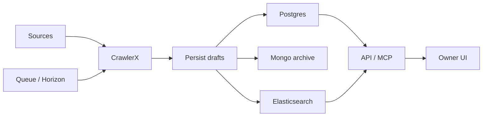
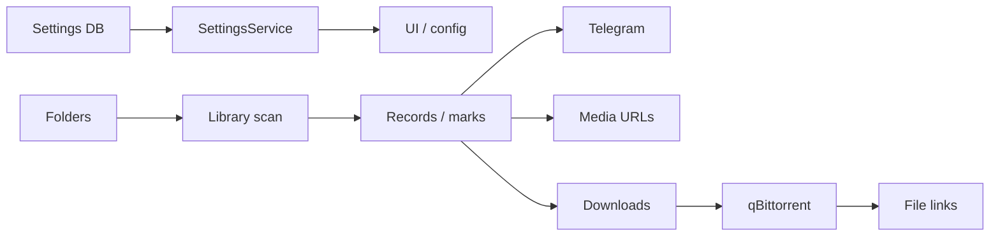

# Architecture

[Guide index](README.md)

The relational database is the system of record. MongoDB archives source data and holds the settings store; Elasticsearch is a derived search index. Sources are configured in database rows, while CrawlerX owns fetching and site parsing. JavMeta owns normalization, identity, field conflict resolution, persistence and serving.

The crawl queue selects listing/detail/performer/gallery jobs. Scheduler commands seed, reclaim and feed jobs; Horizon executes the Laravel queues. Fetch jobs call `CrawlerxClient`, use `SourceNormalizerRegistry` and deliver typed drafts through `MovieDraftSink` / `PerformerDraftSink`. `AppServiceProvider` binds these to the persisters. Listings discover more URLs rather than bypassing persistence.

`MoviePersister` appends field observations, resolves code identity, projects primary values using the conflict policy, unions genres with provenance and links canonical performers. Null observations do not erase known values. A drop of three or more populated core fields retains current fields and flags review. The archive records source data; index jobs update the derived Elasticsearch documents after relational writes. Follow the actual transaction and after-commit handling when extending persistence; these stores are not a single distributed transaction.

`SettingsServiceProvider` applies the Mongo laravel-config `settings` group at boot, before queue jobs and before console commands. Definitions and Vietnamese help text are in `config/javmeta_settings.php`; unset keys use config defaults. Secret types use encrypted storage and expose only an `is_set` indicator to the UI. Tests skip automatic settings application and bind `FakeConfigStore` when needed.

The owner session protects `/app`, `/ops`, `/ui-api/*`, `/ui-admin/*` and `/ui-me/*`. `UiApiController` dispatches an allowlisted GET request to `/api/v1/*` in-process; the internal attribute bypasses API key checks and usage accounting. Owner writes use CSRF via `send()` in `public/ui/js/api.js`. External readers use API keys, while `/api/v1/admin/*` uses `X-Owner-Token`, a separate credential. Never put either credential in browser modules.

Telegram polling runs every minute; follow notifications are checked every five minutes, using owner follows, a lookback window, quiet hours and a daily cap. Library scans inspect mounted files, recognize movie codes and persist presence/size/hash metadata without changing files. The hourly scheduled library command applies the configured daily scan hour. Downloads are explicit owner actions, disabled by default; qBittorrent category filtering isolates managed torrents. Signed file links additionally require the file service switch, permitted roots and client networks.

Media in this branch means source URL references (`MovieMedia`, `PerformerMedia`), gallery metadata and owner-requested downloads/file serving. A separate transcode, thumbnail or stream-capture pipeline is not implemented in this checkout; do not describe an unmerged media branch as available.

Evidence entry points: `routes/api.php`, `routes/web.php`, `routes/console.php`, `app/Jobs/FetchDetailJob.php`, `app/Services/Crawler/CrawlerxClient.php`, `app/Services/Persist/MoviePersister.php`, `app/Services/Archive/MongoSiteArchive.php`, `app/Providers/SettingsServiceProvider.php`, `app/Services/Notifications/FollowNotifier.php`, `app/Services/Library`, `app/Services/Downloads`.
